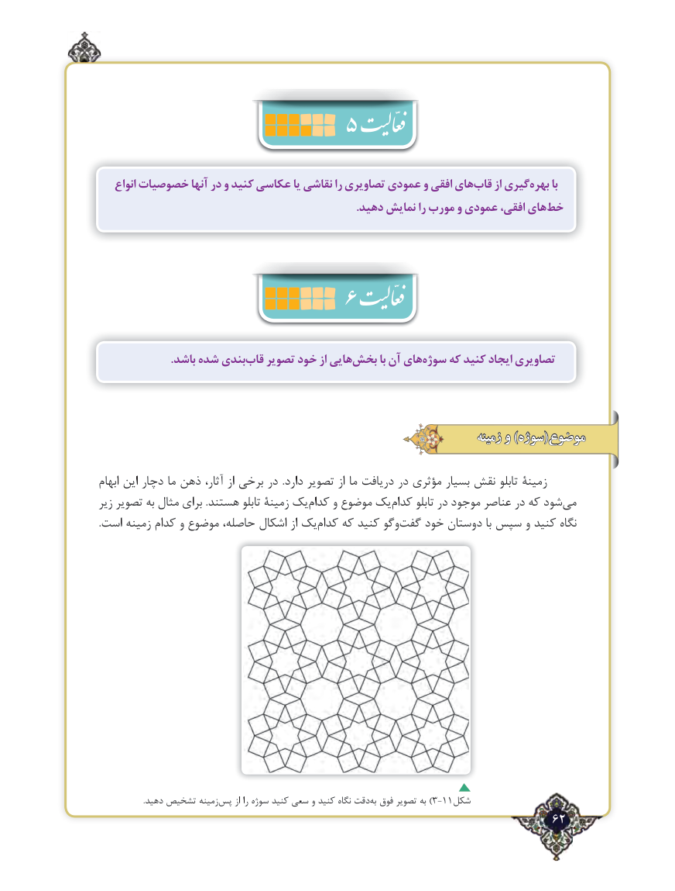

# PDF page 62

انواع خصوصیات آنها در و کنید عکاسی یا نقاشی را تصاویری عمودی و افقی هایقاب‌     از گیریبهره‌      با
   .‌دهید نمایش را مورب و عمودی افقی، هایخط

                     6
                          .باشد شده بندیقاب‌   تصویر خود از هاییبخش‌       با آن هایسوژه‌    که کنید ایجاد تصاویری

                                                                             زمینه و )سوژه(موضوع

ابهام این دچار ما ذهن آثار، از برخی در  .دارد تصویر از ما دریافت در مؤثری بسیار نقش تابلو زمینۀ
زیر تصویر به مثال برای .هستند تابلو زمینۀ یک‌کدام و موضوع یک ‌کدام تابلو در موجود عناصر در که شود ‌می
.‌است زمینه کدام و موضوع حاصله، اشکال از یک کدام که کنید وگوگفت‌   خود دوستان با سپس و کنید نگاه

                        .دهید تشخیص زمینه‌پس از را سوژه کنید سعی و کنید نگاه دقتبه‌)فوق تصویر به 3-11شکل
                                                                   62٢

