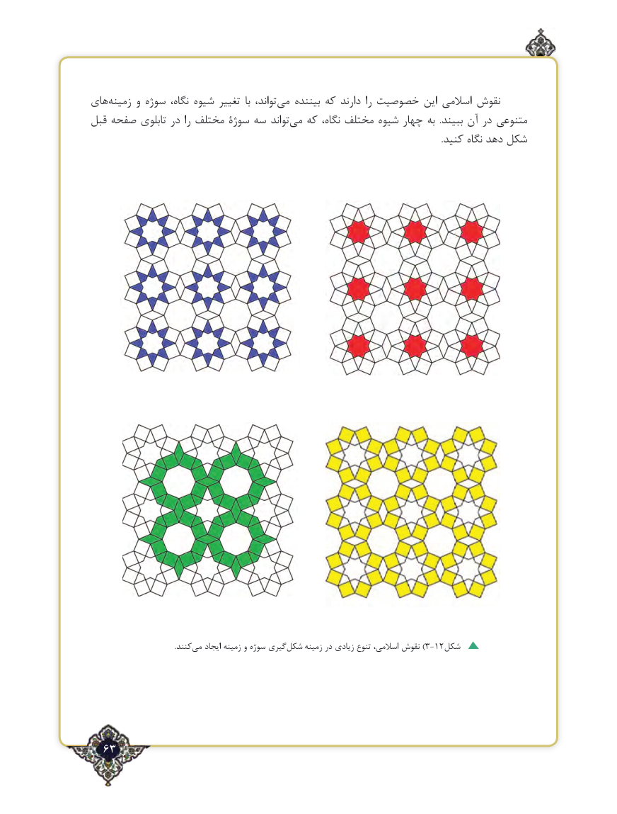

# PDF page 63

های‌زمینه و سوژه نگاه، شیوه تغییر  با تواند، ‌می بیننده که دارند را خصوصیت این اسالمی نقوش
قبل صفحه تابلوی در را مختلف سوژۀ سه تواند ‌می که نگاه، مختلف شیوه چهار به  .ببیند آن در متنوعی
                                                                                                                                                            .کنید نگاه دهد شکل

                                                 .کنندمی‌   ایجاد زمینه و سوژه گیری‌)شکل زمینه در زیادی تنوع اسالمی، نقوش 3-12شکل

  63٢

