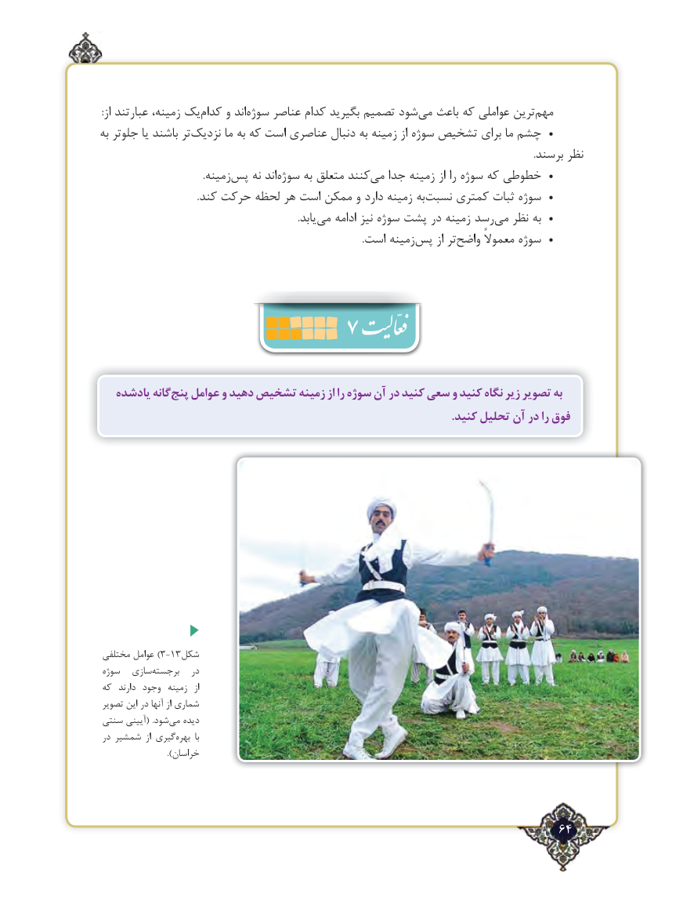

# PDF page 64

:از عبارتند زمینه، یک‌کدام و اندسوژه‌    عناصر کدام بگیرید تصمیم شود ‌می باعث که عواملی ترین‌مهم
به جلوتر یا باشند تر ‌نزدیک ما به که است عناصری دنبال به زمینه از سوژه تشخیص برای ما چشم  •
                                                                                                                                                                              .برسند نظر
      .‌زمینهپس نه اندسوژه‌     به متعلق کنندمی‌   جدا زمینه از را سوژه که خطوطی  •
                                       .کند حرکت لحظه هر است ممکن و دارد زمینه به ‌نسبت کمتری ثبات سوژه  •
                                                                               .یابد ‌می ادامه نیز سوژه پشت در زمینه رسدمی‌   نظر به  •
                                                                                                         .است زمینه ‌پس از تر‌واضح معموالً سوژه  •
                      7

   یادشده گانهپنج‌   عوامل و دهید تشخیص زمینه از را سوژه آن در کنید سعی و کنید نگاه زیر تصویر به
                                                                                                                            .کنید تحلیل آن در را فوق

 مختلفی عوامل )3-13شکل
 سوژه  سازی ‌برجسته   در
 که  دارند وجود  زمینه  از
 تصویر این در آنها از شماری
سنتی آیینی(  .شود ‌می دیده
 در شمشیر  از گیری‌بهره  با
                          ).خراسان

                                                                 64٢

