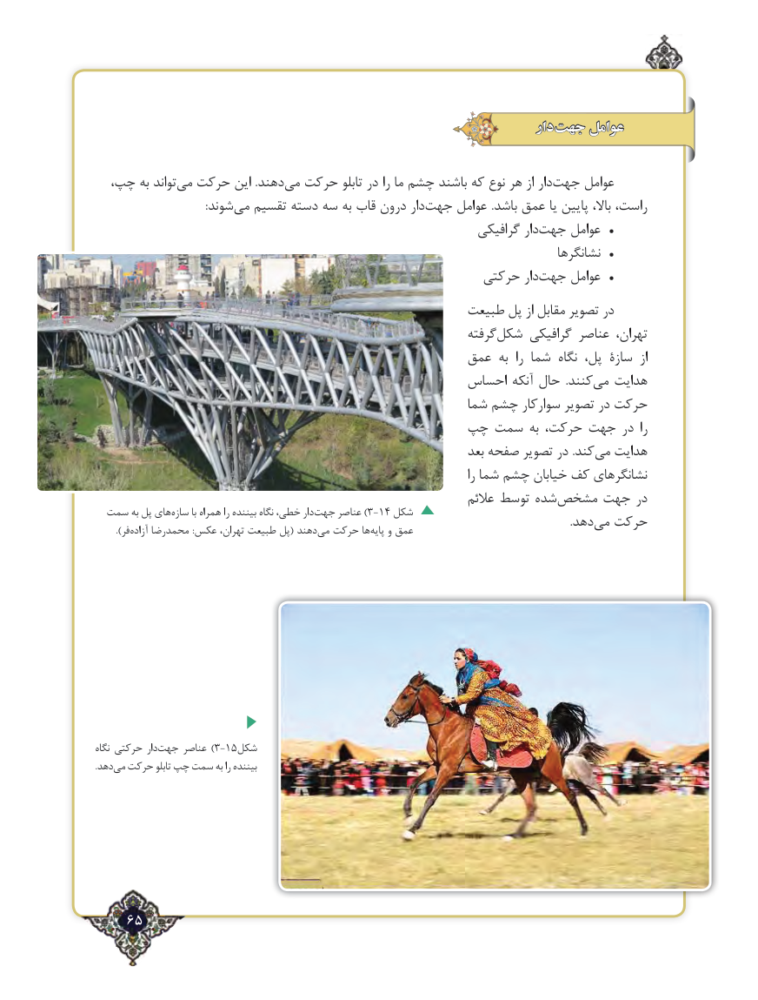

# PDF page 65

دار  جهت عوامل

  چپ، به تواند‌می حرکت این .دهندمی‌  حرکت تابلو در را ما چشم باشند که نوع هر از دار ‌جهت عوامل
       :‌شوند می تقسیم دسته سه به قاب درون دار‌جهت عوامل .باشد عمق یا پایین باال، راست،
                                                               گرافیکی دارجهت‌     عوامل  •
                                                                                     نشانگرها  •
                                                    حرکتی دارجهت‌     عوامل  •
                                                  طبیعت پل از مقابل تصویر در
                                                                گرفته ‌شکل گرافیکی عناصر تهران،
                                               عمق به  را شما  نگاه پل، سازۀ  از
                                               احساس آنکه حال  .کنندمی‌   هدایت
                                                       شما چشم سوارکار تصویر در حرکت
                                   چپ سمت به حرکت، جهت در  را
                                                                   بعد صفحه تصویر در .کندمی‌  هدایت
                                                                                               را شما چشم خیابان کف نشانگرهای
                                                                     عالئم توسط شده‌مشخص جهت در
  سمت به پل های‌سازه با همراه را بیننده نگاه خطی، دار‌)جهت عناصر 3-14 شکل                                  .‌دهد می حرکت    ).‌فر آزاده محمدرضا :عکس تهران، طبیعت پل( دهند‌می حرکت هاپایه‌   و عمق

نگاه حرکتی دارجهت‌)عناصر 3-15شکل
.‌دهدمی حرکت تابلو چپ سمت به را بیننده

    65٢

