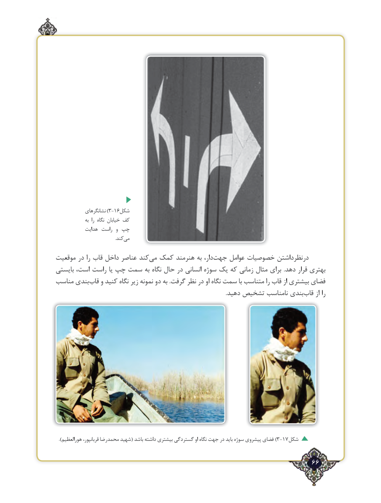

# PDF page 66

نشانگرهای )3-16شکل
               به  را نگاه خیابان کف
           هدایت راست  و چپ
            .‌کندمی

موقعیت در را قاب داخل عناصر کندمی‌  کمک هنرمند به دار،جهت‌     عوامل خصوصیات درنظرداشتن
بایستی است، راست یا چپ سمت به نگاه حال در انسانی سوژه یک که زمانی مثال ‌ برای  .دهد قرار بهتری
مناسب بندیقاب‌   و کنید نگاه زیر نمونه دو به .گرفت نظر در او نگاه سمت با متناسب را قاب از بیشتری فضای
    .‌دهید تشخیص نامناسب بندی قاب از را

).3-17هورالعظیم قربانپور، محمدرضا شهید( باشد داشته بیشتری گستردگی او نگاه جهت در باید سوژه پیشروی فضای )   شکل

                                                                  66٢

