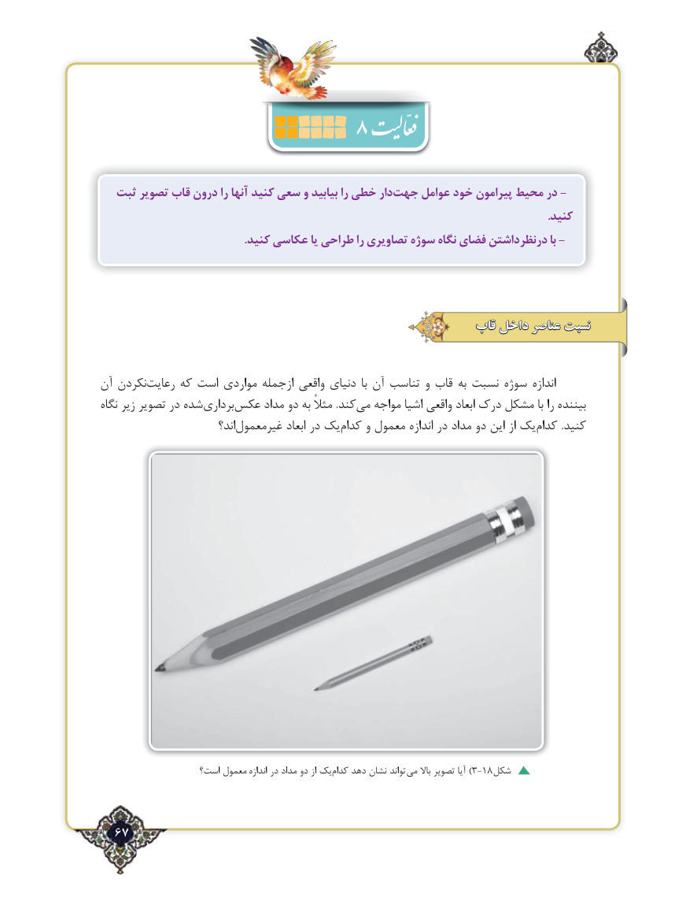

# PDF page 67

ثبت تصویر قاب درون را آنها کنید سعی و بیابید را خطی دارجهت‌    عوامل خود پیرامون محیط در -
                                                                                                                                                             .کنید
 .-کنید عکاسی یا طراحی را تصاویری سوژه نگاه فضای درنظرداشتن با

                                                        قاب داخل عناصر نسبت

آن نکردنرعایت‌     که است مواردی ازجمله واقعی دنیای  با آن تناسب و قاب به ‌ نسبت سوژه اندازه
نگاه زیر تصویر در شده‌برداری‌عکس مداد دو به مثالً .کندمی‌   مواجه اشیا واقعی ابعاد درک مشکل با را بیننده
                           اند؟غیرمعمول‌            ابعاد در یک‌کدام و معمول اندازه در مداد دو این از یک ‌کدام .کنید

                   است؟ معمول اندازه در مداد دو از یک‌کدام دهد نشان تواند  )می باال تصویر آیا 3-18شکل

  67٢

