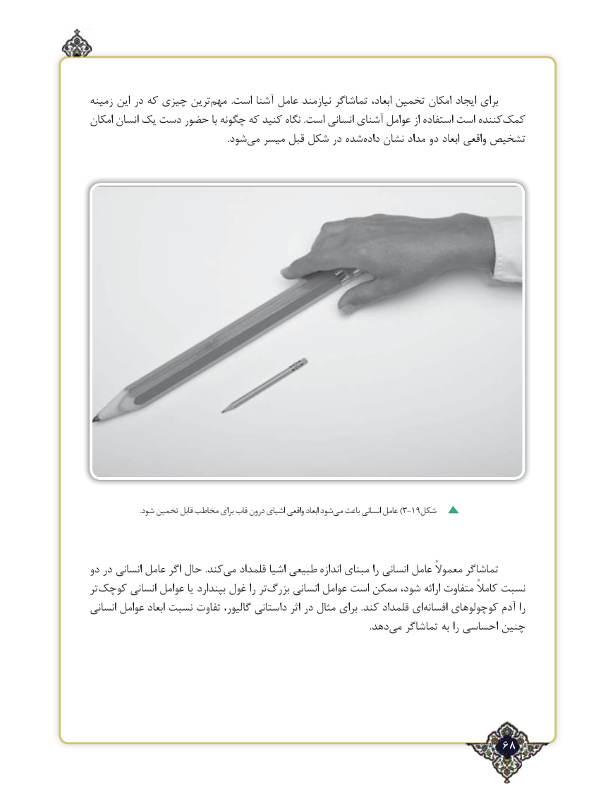

# PDF page 68

زمینه این در که چیزی ترین‌مهم  .است آشنا عامل نیازمند تماشاگر ابعاد، تخمین امکان ایجاد برای
امکان انسان یک دست حضور با چگونه که کنید نگاه .است انسانی آشنای عوامل از استفاده است کنندهکمک‌
            .‌شودمی میسر قبل شکل در شده ‌داده نشان مداد دو ابعاد واقعی تشخیص

                             .شود تخمین قابل مخاطب برای قاب درون اشیای واقعی ابعاد شودمی‌)باعث انسانی عامل 3-19شکل

دو در انسانی عامل اگر حال .کندمی‌   قلمداد اشیا طبیعی اندازه مبنای را انسانی عامل معموالً تماشاگر
تر‌کوچک انسانی عوامل یا بپندارد غول را تر‌بزرگ انسانی عوامل است ممکن شود، ارائه متفاوت کامالً نسبت
انسانی عوامل ابعاد نسبت تفاوت گالیور، داستانی اثر در مثال برای .کند قلمداد ای‌افسانه کوچولوهای آدم را
                         .‌دهد می تماشاگر به را احساسی چنین

                                                             68٢

