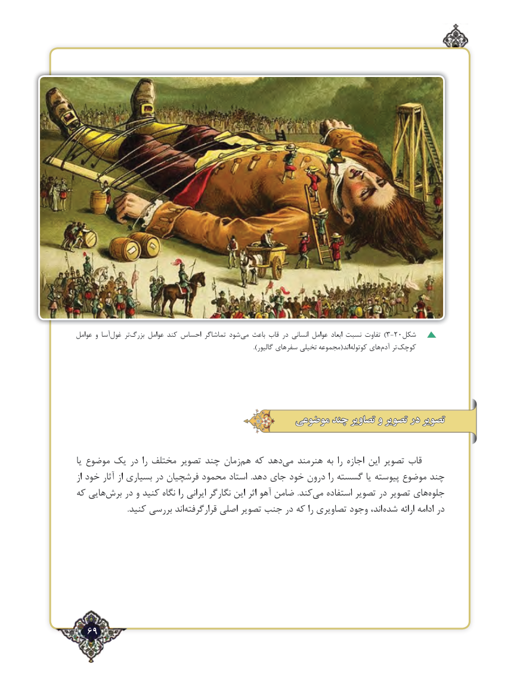

# PDF page 69

عوامل و آسا‌غول تر‌بزرگ عوامل کند احساس تماشاگر شود ‌)می باعث قاب در انسانی عوامل ابعاد نسبت تفاوت 3-20شکل
     ).‌گالیور سفرهای تخیلی مجموعه(اندکوتوله های‌آدم تر‌کوچک

                                      موضوعی چند تصاویر و تصویر در تصویر

یا موضوع یک در را مختلف تصویر چند زمان ‌هم که دهدمی‌   هنرمند به را اجازه این تصویر قاب
از خود آثار از بسیاری در فرشچیان محمود استاد  .دهد جای خود درون را گسسته یا پیوسته موضوع چند
که هایی‌برش در و کنید نگاه را ایرانی نگارگر این اثر آهو ضامن  .کند می‌   استفاده تصویر در تصویر های‌جلوه
  .‌کنید بررسی اندقرارگرفته اصلی تصویر جنب در که را تصاویری وجود اند،  شده ارائه ادامه در

  69٢

