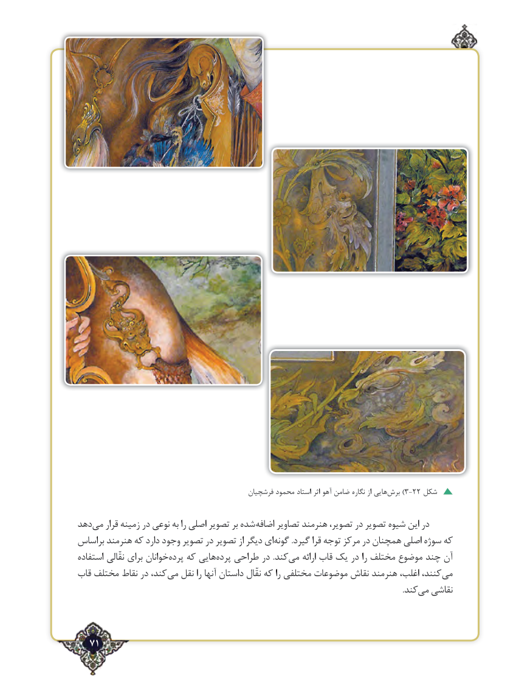

# PDF page 71

فرشچیان محمود استاد اثر آهو ضامن نگاره از هایی‌)برش 3-22 شکل

دهدمی‌   قرار زمینه در نوعی‌به را اصلی تصویر بر شده ضافها‌ تصاویر هنرمند تصویر، در تصویر شیوه این در
براساس هنرمند که دارد وجود تصویر در تصویر از دیگر ایگونه‌        .گیرد قرا توجه مرکز در همچنان اصلی سوژه که
استفاده نقّالی برای خوانانپرده‌   که هاییپرده‌   طراحی در .کندمی‌    ارائه قاب یک در را مختلف موضوع چند آن
قاب مختلف نقاط در کند، می نقل را آنها داستان نقّال که را مختلفی موضوعات نقاش هنرمند اغلب، کنند، می
                                   .‌کندمی نقاشی

  71٢

