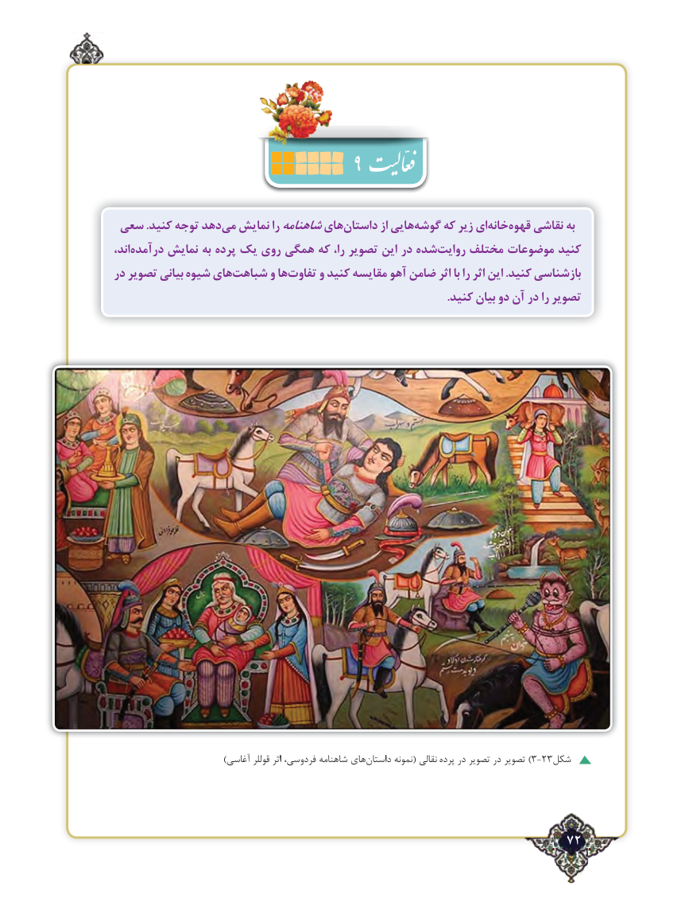

# PDF page 72

سعی .كنيد توجه دهدمی‌  نمایش راشاهنامههایداستان‌        از هاییگوشه‌    كه زير ایخانه‌   قهوه‌    نقاشی به
اند،درآمده‌     نمایش به پرده یک روی همگی که را، تصویر این در شدهروایت‌    مختلف موضوعات کنید
در تصویر بیانی شیوه هايشباهت‌      و هاتفاوت‌     و کنید مقايسه آهو ضامن اثر با را اثر اين .کنید بازشناسی
                                                                                                                    .کنید بیان دو آن در را تصویر

                                 )آغاسی قوللر اثر فردوسی، ‌شاهنامه های‌)داستان نمونه( نقالی پرده در تصویر در تصویر 3-23شکل

                                                             72٢

