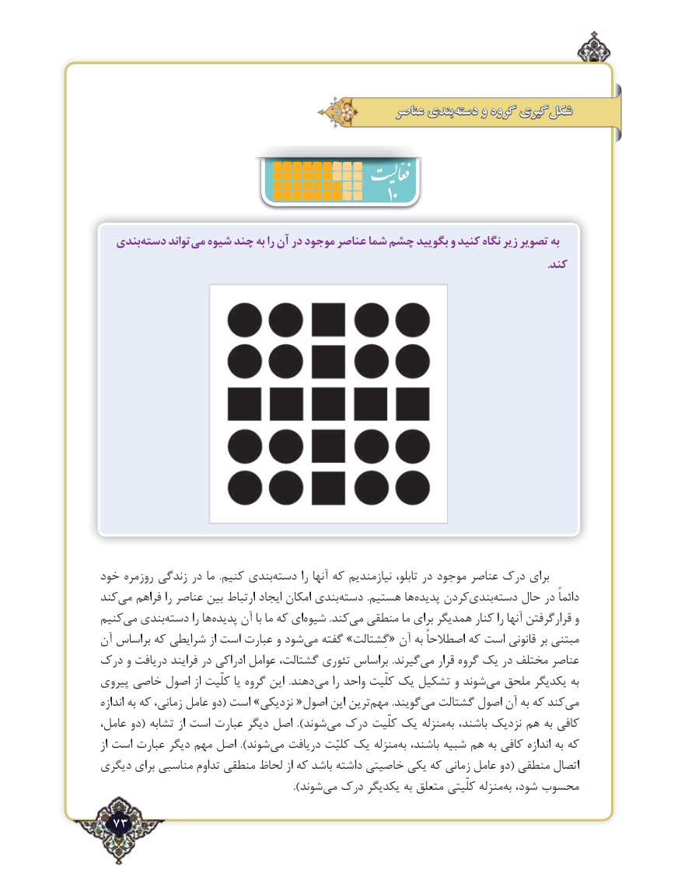

# PDF page 73

عناصر بندی دسته و گروه گیری شکل
                                                    10
   بندیدسته‌     تواند می شیوه چند به را آن در موجود عناصر شما چشم بگویید و کنید نگاه زیر تصویر به
                                                                                                                                                               .کند

خود روزمره زندگی در ما  .کنیم بندی‌دسته را آنها که نیازمندیم تابلو، در موجود عناصر درک برای
کندمی‌   فراهم را عناصر بین ارتباط ایجاد امکان بندیدسته‌          .هستیم ها ‌پدیده کردنبندی‌      ‌دسته حال در دائماً
کنیممی‌  بندی‌دسته را هاپدیده‌    آن با ما که ای‌شیوه .کندمی‌  منطقی ما برای همدیگر کنار را آنها قرارگرفتن و
آن براساس که شرایطی از است عبارت و شود ‌می گفته »گِشتالت« آن به اصطالحاً که است قانونی بر ‌مبتنی
درک و دریافت فرایند در ادراکی عوامل گشتالت، تئوری براساس .گیرندمی‌   قرار گروه یک در مختلف عناصر
پیروی خاصی اصول از کلّیت یا گروه این  .دهندمی‌    را واحد کلّیت یک تشکیل و شوند ‌می ملحق یکدیگر به
اندازه به که زمانی، عامل دو( است »نزدیکی «اصول این ترین‌مهم .گویندمی‌  گشتالت اصول آن به که کندمی‌
عامل، دو( تشابه از است عبارت دیگر اصل ).شوند ‌می درک کلّیت یک منزله ‌به باشند، نزدیک هم به کافی
از است عبارت دیگر مهم اصل ).شوند‌می دریافت کلیّت یک منزله ‌به باشند، شبیه هم به کافی اندازه به که
دیگری برای مناسبی تداوم منطقی لحاظ از که باشد داشته خاصیتی یکی که زمانی عامل دو( منطقی اتصال
                                                         ).شوند‌می درک یکدیگر به متعلق کلّیتی منزله ‌به شود، محسوب
  73٢

