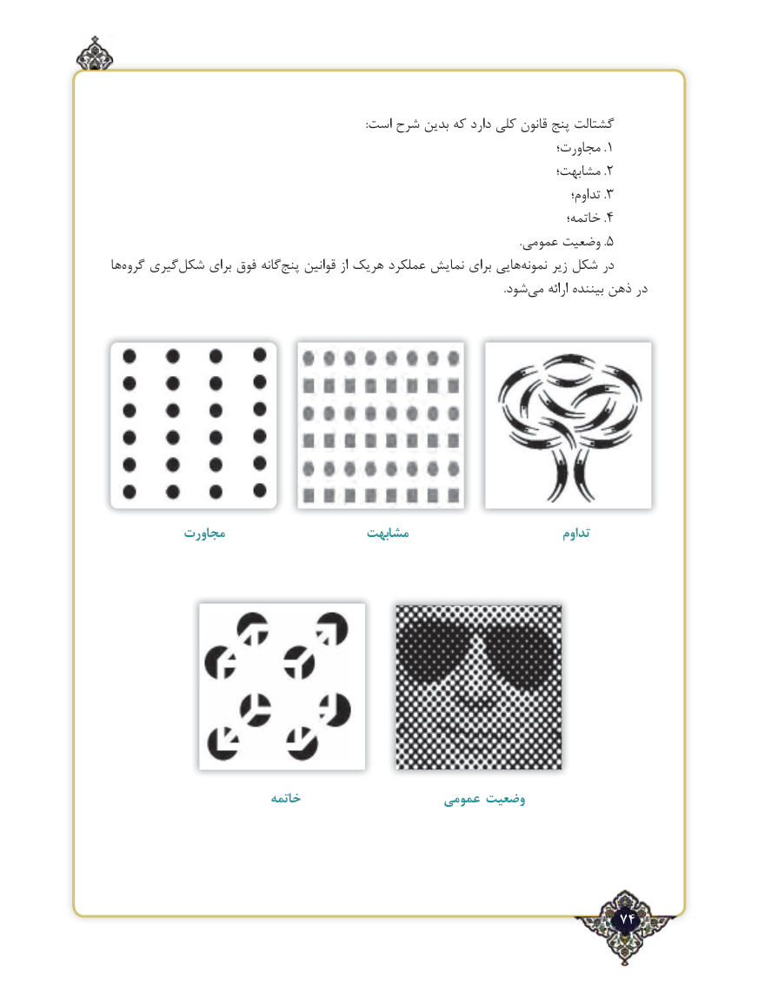

# PDF page 74

:است شرح بدین که دارد کلی قانون پنج گشتالت
                                                                      مجاورت؛ .1
                                                                      مشابهت؛ .2
                                                                                             تداوم؛ .3
                                                                                خاتمه؛ .4
                                                                                                                                                    .عمومی وضعیت .5
ها ‌گروه گیری‌شکل برای فوق گانهپنج‌    قوانین از هریک عملکرد نمایش برای هایینمونه‌     زیر شکل در
                            .‌شود می ارائه بیننده ذهن در

          مجاورت                    مشابهت                           تداوم

                          خاتمه                   عمومی وضعیت

                                                              74٢

