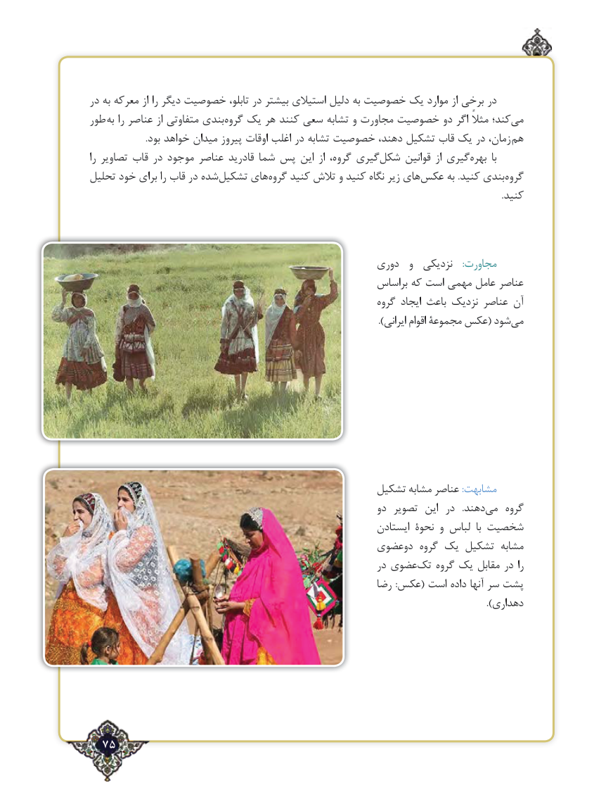

# PDF page 75

در‌به معرکه از را دیگر خصوصیت تابلو، در بیشتر استیالی دلیل به خصوصیت یک موارد از برخی در
طور به را عناصر از متفاوتی بندی‌گروه یک هر کنند سعی تشابه و مجاورت خصوصیت دو اگر مثالً کند؛می‌
                         .بود خواهد میدان پیروز اوقات اغلب در تشابه خصوصیت دهند، تشکیل قاب یک در زمان،  هم
را تصاویر قاب در موجود عناصر قادرید شما پس‌ این از گروه، گیریشکل‌     قوانین از گیری‌بهره  با
تحلیل خود برای را قاب در شده‌تشکیل های ‌گروه کنید تالش و کنید نگاه زیر های‌عکس به .کنید بندی‌گروه
                                                                                                                                                                                        .کنید

                                                    دوری  و  نزدیکی    :مجاورت
                                                        براساس که است مهمی عامل عناصر
                                                              گروه ایجاد باعث نزدیک عناصر آن
      ).‌ایرانی اقوام مجموعۀ عکس( شودمی

                                                 تشکیل مشابه عناصر :مشابهت
                                                            دو تصویر  این  در   .دهندمی‌    گروه
                                                             ایستادن نحوۀ و لباس  با شخصیت
                                                دوعضوی گروه یک تشکیل مشابه
                                                             در عضویتک‌   گروه یک مقابل در را
                                                         رضا :عکس( است داده آنها سر پشت
                                                                                                                                      ).دهداری

  75٢

