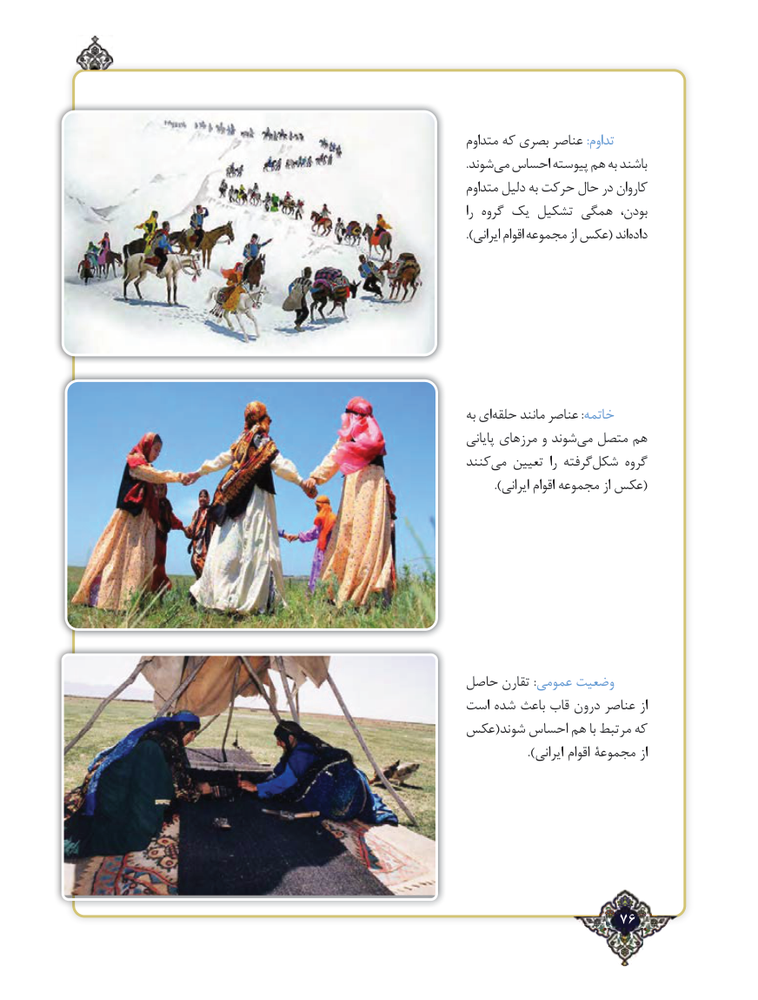

# PDF page 76

متداوم که بصری عناصر :تداوم
.شوندمی‌  احساس پیوسته هم به باشند
متداوم دلیل به حرکت حال در کاروان
را گروه یک تشکیل همگی بودن،
).‌ایرانی اقوام مجموعه از عکس( اندداده

به ایحلقه‌     مانند عناصر :خاتمه
پایانی مرزهای و شوندمی‌  متصل هم
کنندمی‌   تعیین  را گرفتهشکل‌     گروه
        ).ایرانی اقوام مجموعه از عکس(

حاصل تقارن :عمومی وضعیت
است شده باعث قاب درون عناصر از
عکس(شوند احساس هم با مرتبط که
                ).ایرانی اقوام مجموعۀ از

                   76٢

