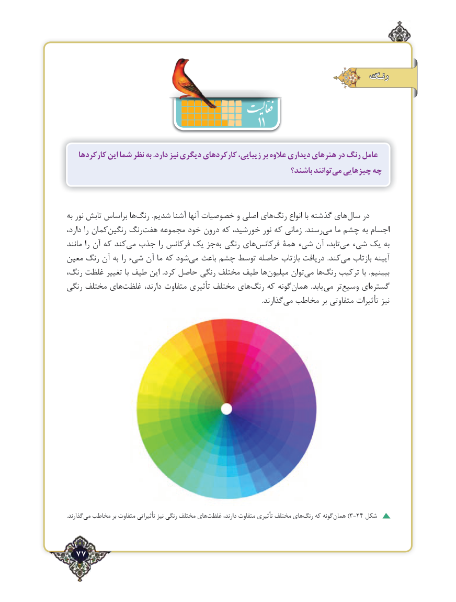

# PDF page 77

رنـگ
                                                      11
   کارکردها این شما نظر به .دارد نیز دیگری کارکردهای زیبایی، بر عالوه دیداری هنرهای در رنگ عامل
                                                              باشند؟ توانندمی‌  چیزهایی چه

به نور تابش براساس هارنگ‌        .شدیم آشنا آنها خصوصیات و اصلی های ‌رنگ انواع با گذشته های‌سال در
دارد، را کمان‌رنگین رنگ‌هفت مجموعه خود درون که خورشید، نور که زمانی  .رسند‌می ما چشم به اجسام
مانند را آن که کندمی‌  جذب را فرکانس یک جز‌به رنگی های‌فرکانس همۀ شیء آن تابد، ‌می شیء یک به
معین رنگ آن به را شیء آن ما که شود‌می باعث چشم توسط حاصله بازتاب دریافت  .کندمی‌   بازتاب آیینه
رنگ، غلظت تغییر با طیف این  .کرد حاصل رنگی مختلف طیف ها ‌میلیون توان‌می ها‌رنگ ترکیب با  .ببینیم
رنگی مختلف های‌غلظت دارند، متفاوت تأثیری مختلف های‌رنگ که گونه ‌همان  .یابد ‌می تر‌وسیع ای‌گستره
                                                                                                                     .گذارندمی‌  مخاطب بر متفاوتی تأثیرات نیز

.گذارندمی‌  مخاطب بر متفاوت تأثیراتی نیز رنگی مختلف های‌غلظت دارند، متفاوت تأثیری مختلف های ‌رنگ که گونه‌)همان 3-24 شکل

  77٢

