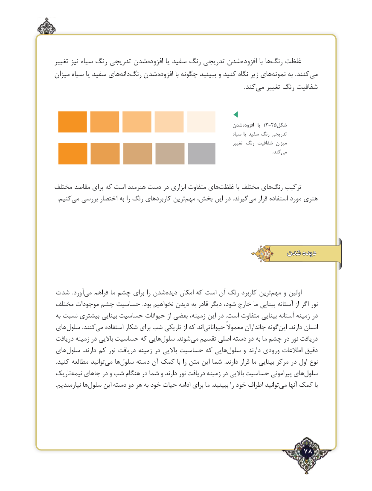

# PDF page 78

تغییر نیز سیاه رنگ تدریجی شدن ‌افزوده یا سفید رنگ تدریجی شدن ‌افزوده با ها ‌رنگ غلظت
میزان سیاه یا سفید های‌دانهرنگ‌   شدن ‌افزوده با چگونه ببینید و کنید نگاه زیر های‌نمونه به .کنندمی‌
                           .‌کندمی تغییر رنگ شفافیت

                                                       شدن ‌)افزوده   با  3-25شکل
                                                                                  سیاه یا سفید رنگ تدریجی
                                                                                          تغییر رنگ شفافیت میزان
                                            .‌کندمی

مختلف مقاصد برای که است هنرمند دست در ابزاری متفاوت هایغلظت‌         با مختلف های‌رنگ ترکیب
.‌کنیممی بررسی اختصار‌به را رنگ کاربردهای ترین‌مهم بخش، این در .گیرند ‌می قرار استفاده مورد هنری

                                                   شدنشدن دیدهدیده

شدت  .آوردمی‌   فراهم ما چشم برای را شدن‌دیده امکان که است آن رنگ کاربرد ترین‌مهم و اولین
مختلف موجودات چشم حساسیت  .بود نخواهیم دیدن به قادر دیگر شود، خارج ما بینایی آستانه از اگر نور
 به‌ نسبت بیشتری بینایی حساسیت حیوانات از بعضی زمینه، این در  .است متفاوت بینایی آستانه زمینه در
های‌سلول .کنندمی‌   استفاده شکار برای شب تاریکی از که اند ‌حیواناتی معموالً جانداران گونهاین‌      .دارند انسان
دریافت زمینه در باالیی حساسیت که هایی‌سلول .شوند ‌می تقسیم اصلی دسته دو به ما چشم در نور دریافت
های‌سلول  .دارند کم نور دریافت زمینه در باالیی حساسیت که هایی‌سلول و دارند ورودی اطالعات دقیق
 .کنید مطالعه توانید ‌می ها‌سلول دسته آن کمک با را متن این شما  .دارند قرار ما بینایی مرکز در اول نوع
تاریک‌نیمه جاهای در و شب هنگام در شما و دارند نور دریافت زمینه در باالیی حساسیت پیرامونی های‌سلول
.‌نیازمندیم هاسلول این دسته دو هر به خود حیات ادامه برای ما .ببینید را خود اطراف توانید‌می آنها کمک با

                                                          78٢

