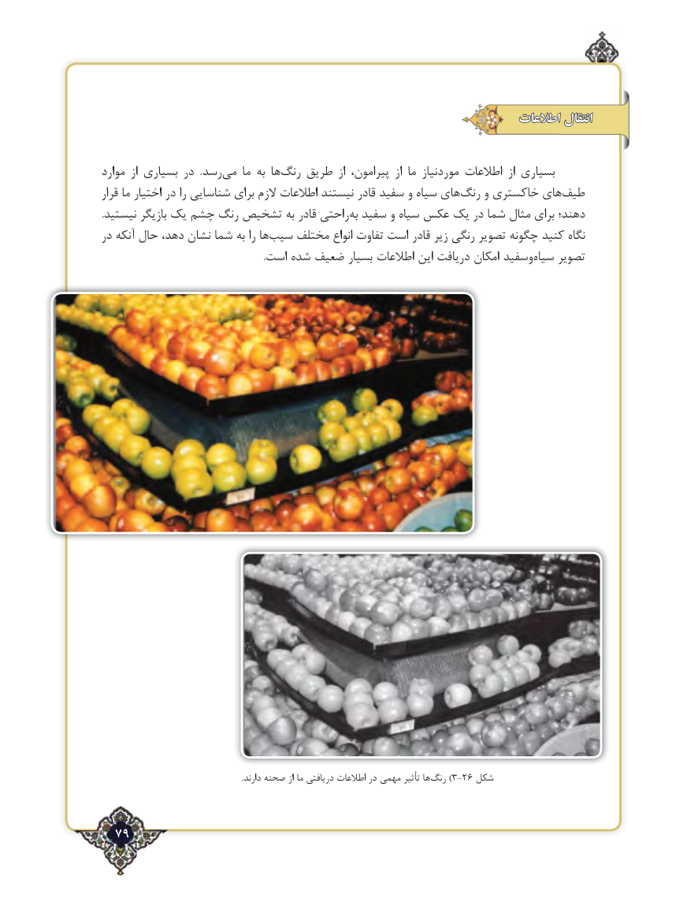

# PDF page 79

اطالعات انتقال

موارد  از بسیاری در  .رسد‌می ما به ها ‌رنگ طریق  از پیرامون،  از ما موردنیاز اطالعات  از بسیاری
قرار ما اختیار در را شناسایی برای الزم اطالعات نیستند قادر سفید و ‌سیاه های‌رنگ و خاکستری های‌طیف
.نیستید بازیگر یک چشم رنگ تشخیص به قادر راحتیبه‌ سفید و‌سیاه عکس یک در شما مثال ‌برای دهند؛
در آنکه ‌حال دهد، نشان شما به را ها ‌سیب مختلف انواع تفاوت است قادر زیر رنگی تصویر چگونه کنید نگاه
 .‌است شده ضعیف بسیار اطالعات این دریافت امکان وسفید سیاه تصویر

                                                                         .دارند صحنه از ما دریافتی اطالعات در مهمی تأثیر ها‌)رنگ 3-26 شکل

  79٢

