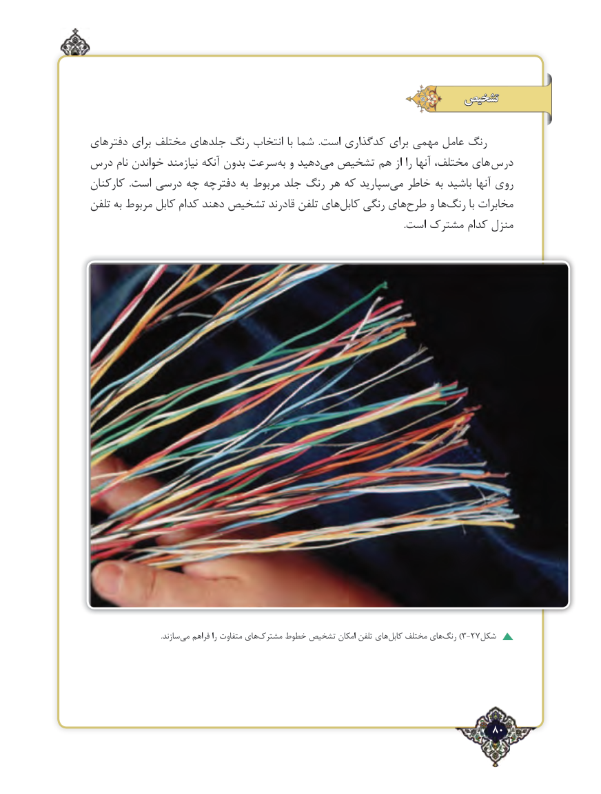

# PDF page 80

تشخیص

دفترهای برای مختلف جلدهای رنگ انتخاب با شما  .است کدگذاری برای مهمی عامل رنگ
درس نام خواندن نیازمند آنکه بدون سرعتبه‌  و دهید ‌می تشخیص هم از را آنها مختلف، های  درس
کارکنان  .است درسی چه دفترچه به مربوط جلد رنگ هر که سپارید‌می خاطر به باشید آنها روی
تلفن به مربوط کابل کدام دهند تشخیص قادرند تلفن های ‌کابل رنگی های‌طرح و ها‌رنگ با مخابرات
                                                                                                                                     .است مشترک کدام منزل

                                          .سازند‌می فراهم را متفاوت های‌مشترک خطوط تشخیص امکان تلفن های ‌کابل مختلف های ‌)رنگ 3-27شکل

                                                                      80٢

