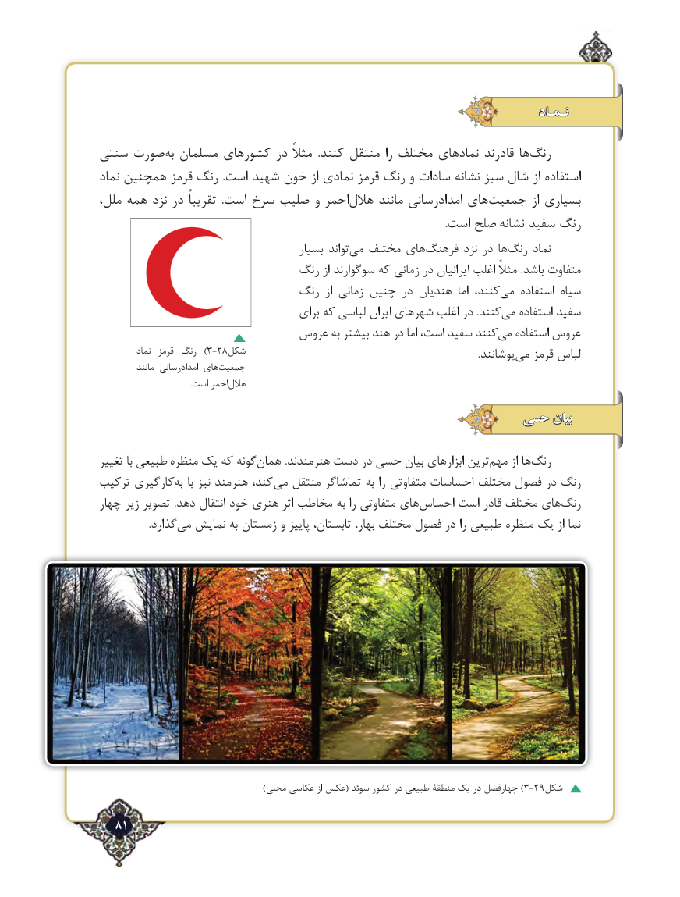

# PDF page 81

نـمـاد

سنتی صورت‌به مسلمان کشورهای در مثالً  .کنند منتقل را مختلف های‌نماد قادرند ها‌رنگ
نماد همچنین قرمز رنگ  .است شهید خون از نمادی قرمز رنگ و سادات نشانه سبز شال از استفاده
ملل، همه نزد در تقریباً  .است سرخ صلیب و احمر‌هالل مانند امدادرسانی های‌جمعیت از بسیاری
                                                                                                                                 .است صلح نشانه سفید رنگ
                                         بسیار تواند ‌می مختلف های ‌فرهنگ نزد در ها‌رنگ نماد
                              رنگ از سوگوارند که زمانی در ایرانیان اغلب مثالً .باشد متفاوت
                              رنگ  از زمانی چنین در هندیان  اما کنند،می‌   استفاده سیاه
                                       برای که لباسی ایران شهرهای اغلب در .کنندمی‌   استفاده سفید
                           عروس به بیشتر هند در اما است، سفید کنند‌می استفاده عروس
          نماد  قرمز رنگ  )3-28شکل           .‌پوشانند می قرمز لباس
           مانند امدادرسانی های ‌جمعیت
    .‌است احمرهالل

                                                حسی بیان

تغییر با طبیعی منظره یک که گونههمان‌          .هنرمندند دست در حسی بیان ابزارهای ترین‌مهم از ها‌رنگ
ترکیب کارگیریبه‌   با نیز هنرمند کند،  می منتقل تماشاگر به را متفاوتی احساسات مختلف فصول در رنگ
چهار زیر تصویر  .دهد انتقال خود هنری اثر مخاطب به را متفاوتی های ‌احساس است قادر مختلف های ‌رنگ
   .‌گذاردمی نمایش به زمستان و پاییز تابستان، بهار، مختلف فصول در را طبیعی منظره یک از نما

 ))محلی عکاسی از عکس( سوئد کشور در طبیعی منطقۀ یک در چهارفصل 3-29شکل

  81٢

