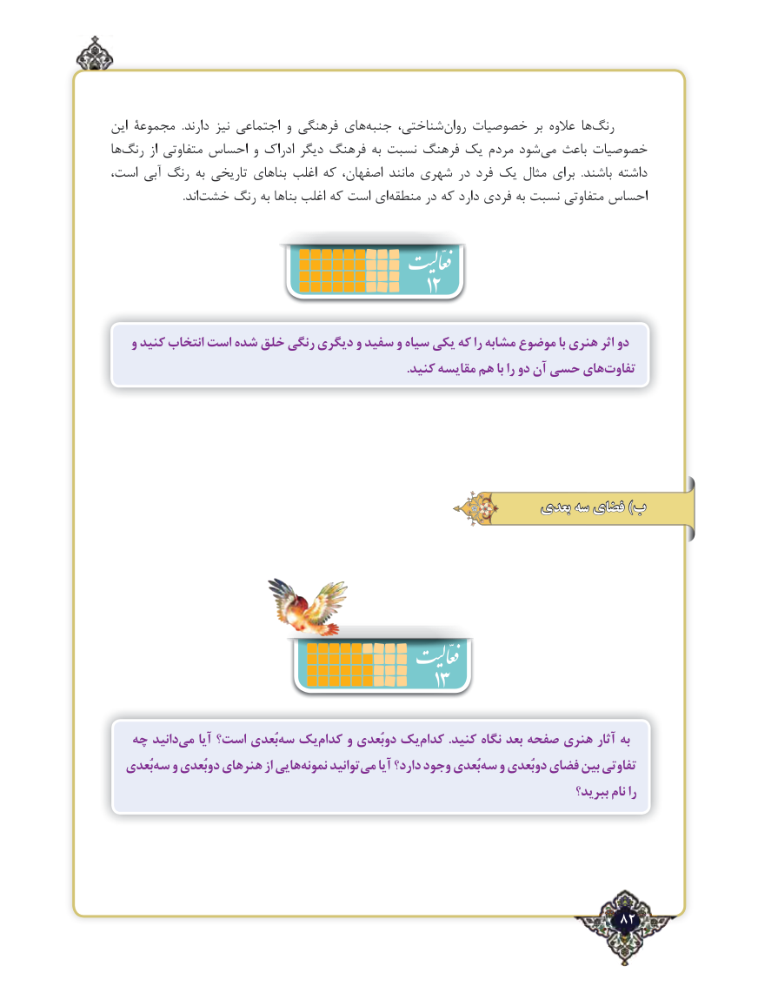

# PDF page 82

این مجموعۀ  .دارند نیز اجتماعی و فرهنگی های ‌جنبه شناختی، ‌روان خصوصیات بر عالوه ها ‌رنگ
ها‌رنگ از متفاوتی احساس و ادراک دیگر فرهنگ به ‌ نسبت فرهنگ یک مردم شود‌می باعث خصوصیات
است، آبی رنگ به تاریخی بناهای اغلب که اصفهان، مانند شهری در فرد یک مثال برای  .باشند داشته
       .‌اند خشت رنگ به بناها اغلب که است ایمنطقه‌     در که دارد فردی به‌نسبت متفاوتی احساس
                                            12
   و کنید انتخاب است شده خلق رنگی دیگری و سفید و‌سیاه یکی که را مشابه موضوع با هنری اثر دو
   .‌کنید مقایسه هم با را دو آن حسی هایتفاوت

                                                         بعدی سه فضای )ب

                                       13
   چه دانيدمي‌    آيا است؟ بُعديسه‌  يككدام‌    و دوبُعدي يككدام‌        .كنيد نگاه بعد صفحه هنري آثار به
   بُعديسه‌   و دوبُعدي هنرهاي از هايينمونه‌     توانيدمي‌   آيا دارد؟ وجود بُعديسه‌   و دوبُعدي فضاي بين تفاوتي
                                                                                   ببريد؟ نام را

                                                              82٢

