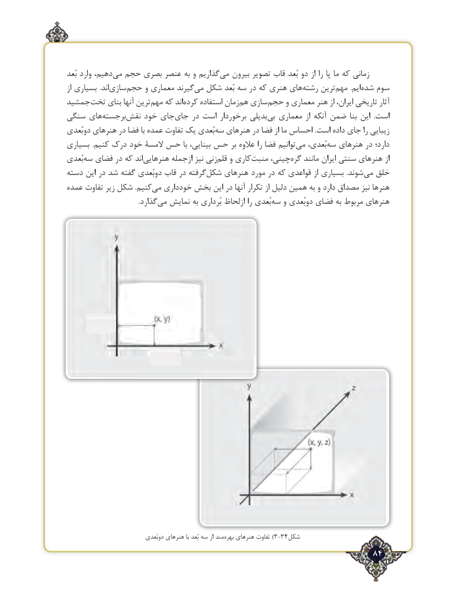

# PDF page 84

بُعد وارد دهیم،می‌  حجم بصری عنصر به و گذاریم ‌می بیرون تصویر قاب بُعد دو از را پا ما که زمانی
از بسیاری  .اند ‌سازی‌حجم و معماری گیرندمی‌  شکل بُعد سه در که هنری های‌رشته ترین‌مهم  .ایم‌شده سوم
جمشید ‌تخت بنای آنها ترین‌مهم که اندکرده‌    استفاده زمان‌هم سازی‌حجم و معماری هنر از ایران، تاریخی آثار
سنگی های ‌برجستهنقش‌    خود جای‌جای در است برخوردار بدیلیبی‌  معماری از آنکه ضمن بنا این  .است
دوبُعدی هنرهای در فضا با عمده تفاوت یک بُعدی ‌سه هنرهای در فضا از ما احساس .است داده ‌جای را زیبایی
بسیاری  .کنیم درک خود المسۀ حس با بینایی، حس بر عالوه را فضا توانیم ‌می بُعدی، ‌سه هنرهای در دارد؛
بُعدی‌سه فضای در که اندهنرهایی‌       ازجمله نیز زنیقلم‌   و کاری‌منبت چینی،گره‌   مانند ایران سنتی هنرهای از
دسته این در شد گفته دوبُعدی قاب در گرفته‌شکل هنرهای مورد در که قواعدی از بسیاری  .شوند‌می خلق
عمده تفاوت زیر شکل .کنیممی‌  خودداری بخش این در آنها تکرار از دلیل همین به و دارد مصداق نیز هنرها
       .‌گذاردمی نمایش به بُرداری ازلحاظ را بُعدی ‌سه و دوبُعدی فضای به مربوط هنرهای

                              دوبُعدی هنرهای با بُعد سه از مند‌)بهره هنرهای تفاوت 3-34شکل
                                                             84٢

