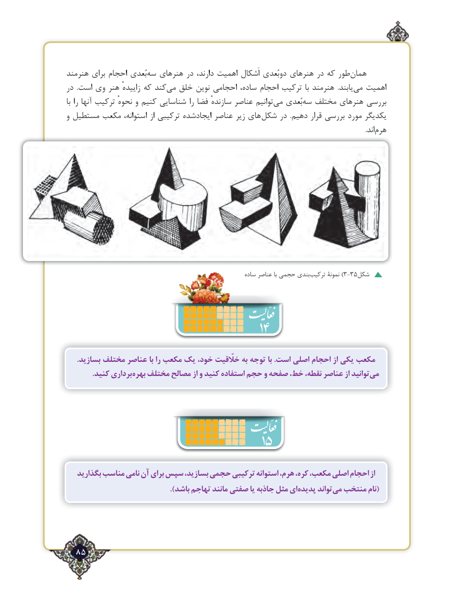

# PDF page 85

هنرمند برای احجام بُعدی‌سه هنرهای در دارند، اهمیت اَشکال دوبُعدی هنرهای در که طور‌همان
در  .است وی هنر زاییدهٔ که کندمی‌  خلق نوین احجامی ساده، احجام ترکیب  با هنرمند  .یابند ‌می اهمیت
با را آنها ترکیب نحوهٔ و کنیم شناسایی را فضا سازندهٔ عناصر توانیم‌می بُعدی ‌سه مختلف هنرهای بررسی
و مستطیل مکعب استوانه، از ترکیبی ایجادشده عناصر زیر های  شکل در  .دهیم قرار بررسی مورد یکدیگر
                                                                                                                                                                                    .اند ‌هرم

                                                               ساده عناصر با حجمی بندی ‌)ترکیب نمونۀ 3-35شکل
                                       14
      .بسازید مختلف عناصر با را مکعب یک خود، خلّقیت به توجه با .است اصلی احجام از یکی مکعب
 . کنید برداری بهره مختلف مصالح از و کنید استفاده حجم و صفحه خط، نقطه، عناصر از توانیدمی‌

                                   15
   بگذارید مناسب نامی آن برای سپس بسازید، حجمی ترکیبی استوانه هرم، کره، مکعب، اصلی احجام از
  ).‌باشد تهاجم مانند صفتی یا جاذبه مثل ایپدیده تواندمی‌(منتخب نام

  85٢

