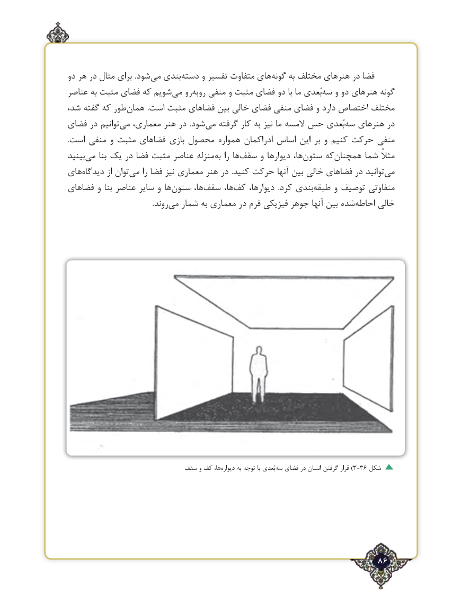

# PDF page 86

دو هر در مثال برای .شود‌می بندی‌دسته و تفسیر متفاوت هایگونه‌     به مختلف هنرهای در فضا
عناصر به مثبت فضای که شویم ‌می روبه‌ ‌رو منفی و مثبت فضای دو با ما بُعدی‌سه و دو هنرهای گونه
شد، گفته که طور ‌همان .است مثبت فضاهای بین خالی فضای منفی فضای و دارد اختصاص مختلف
فضای در توانیم‌می معماری، هنر در  .شود‌می گرفته کار به نیز ما المسه حس بُعدی‌سه هنرهای در
.است منفی و مثبت فضاهای بازی محصول همواره ادراکمان اساس این بر و کنیم حرکت منفی
بینیدمی‌    بنا یک در فضا مثبت عناصر منزله‌به را ها‌سقف و دیوارها ها،ستون‌     که‌همچنان شما مثالً
های ‌دیدگاه از توان‌می را فضا نیز معماری هنر در  .کنید حرکت آنها بین خالی فضاهای در توانیدمی‌
فضاهای و بنا عناصر سایر و هاستون‌      ها، ‌سقف ها، ‌کف دیوارها،  .کرد بندیطبقه‌     و توصیف متفاوتی
         .‌روندمی شمار به معماری در فرم فیزیکی جوهر آنها بین شده‌احاطه خالی

                            سقف و کف ها،‌دیواره به توجه با بُعدی‌)سه فضای در انسان گرفتن قرار 3-36 شکل

                                                             86٢

