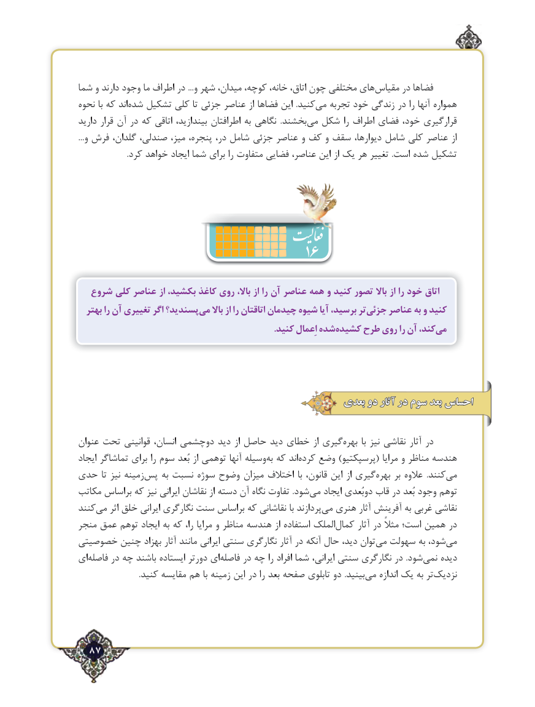

# PDF page 87

شما و دارند وجود ما اطراف در ...و شهر میدان، کوچه، خانه، اتاق، چون مختلفی های‌مقیاس در فضاها
نحوه با که اند‌شده تشکیل کلی تا جزئی عناصر از فضاها این  .کنیدمی‌   تجربه خود زندگی در را آنها همواره
دارید قرار آن در که اتاقی بیندازید، اطرافتان به نگاهی  .بخشند ‌می شکل را اطراف فضای خود، قرارگیری
...و فرش گلدان، صندلی، میز، پنجره، در، شامل جزئی عناصر و کف و سقف دیوارها، شامل کلی عناصر از
                         .کرد خواهد ایجاد شما برای را متفاوت فضایی عناصر، این از یک هر تغییر .است شده تشکیل

                                  16
  شروع کلی عناصر از بکشید، کاغذ روی باال، از را آن عناصر همه و کنید تصور باال از را خود اتاق
  بهتر را آن تغییری اگر پسندید؟می‌    باال از را اتاقتان چیدمان شیوه آیا برسید، ترجزئی‌    عناصر به و کنید
      .‌کنید اِعمال شدهکشیده طرح روی را آن کند،می‌

                                                  بعدی دو آثار در سوم بعد احساس

عنوان تحت قوانینی انسان، دوچشمی دید از حاصل دید خطای از گیریبهره‌       با نیز نقاشی آثار در
ایجاد تماشاگر برای را سوم بُعد از توهمی آنها وسیله‌به که اند ‌کرده وضع )پرسپکتیو( مرایا و مناظر هندسه
حدی تا نیز زمینهپس‌    به‌ نسبت سوژه وضوح میزان اختالف  با قانون، این از گیری‌بهره بر عالوه  .کنندمی‌
مکاتب براساس که نیز ایرانی نقاشان از دسته آن نگاه تفاوت .شود‌می ایجاد دوبُعدی قاب در بُعد وجود توهم
کنندمی‌    اثر خلق ایرانی نگارگری سنت براساس که نقاشانی با پردازندمی‌  هنری آثار آفرینش به غربی نقاشی
منجر عمق توهم ایجاد به که را، مرایا و مناظر هندسه از استفاده الملک ‌کمال آثار در مثالً است؛ همین در
خصوصیتی چنین بهزاد آثار مانند ایرانی سنتی نگارگری آثار در آنکه‌حال دید، توان‌می سهولت ‌به شود،‌می
ای ‌فاصله در چه باشند ایستاده دورتر ای ‌فاصله در چه را افراد شما ایرانی، سنتی نگارگری در .شود ‌نمی دیده
 .‌کنید مقایسه هم با زمینه این در را بعد صفحه تابلوی دو .بینید می اندازه یک به تر ‌نزدیک

  87٢

