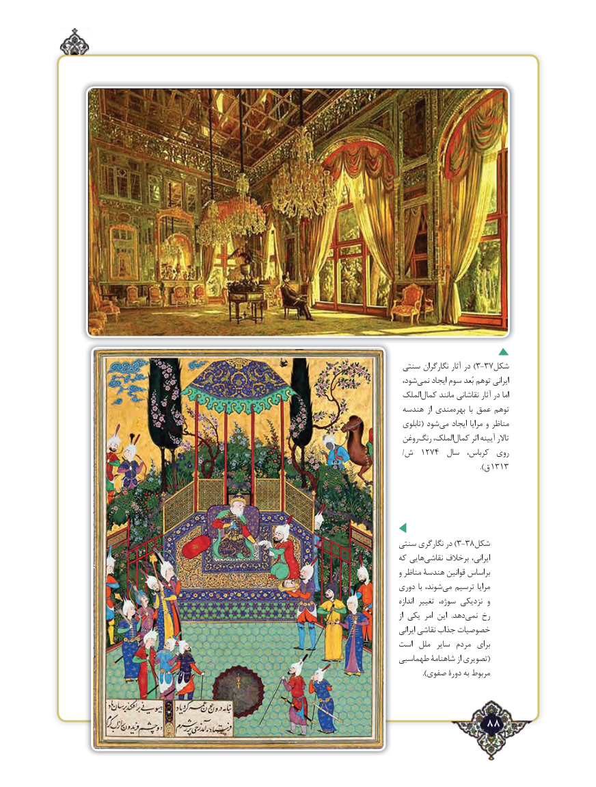

# PDF page 88

سنتی نگارگران آثار در ) 3-37شکل
 شود،نمی‌    ایجاد سوم بُعد توهم ایرانی
 الملککمال‌     مانند نقاشانی آثار در اما
 هندسه  از مندیبهره‌       با عمق توهم
 تابلوی( شودمی‌   ایجاد مرایا و مناظر
 روغنرنگ‌    الملک،کمال‌      اثر آیینه تاالر
 /1274ش        سال  کرباس،  روی
                    ). 1313ق

سنتی نگارگری در ) 3-38شکل
که هایینقاشی‌     برخالف ایرانی،
و مناظر هندسۀ قوانین براساس
دوری با شوند،می‌   ترسیم مرایا
اندازه تغییر سوژه، نزدیکی و
از یکی امر این  .دهدنمی‌   رخ
ایرانی نقاشی جذاب خصوصیات
است  ملل  سایر  مردم  برای
طهماسبی شاهنامۀ از تصویری(
           ).صفوی دورۀ به مربوط

             88٢

