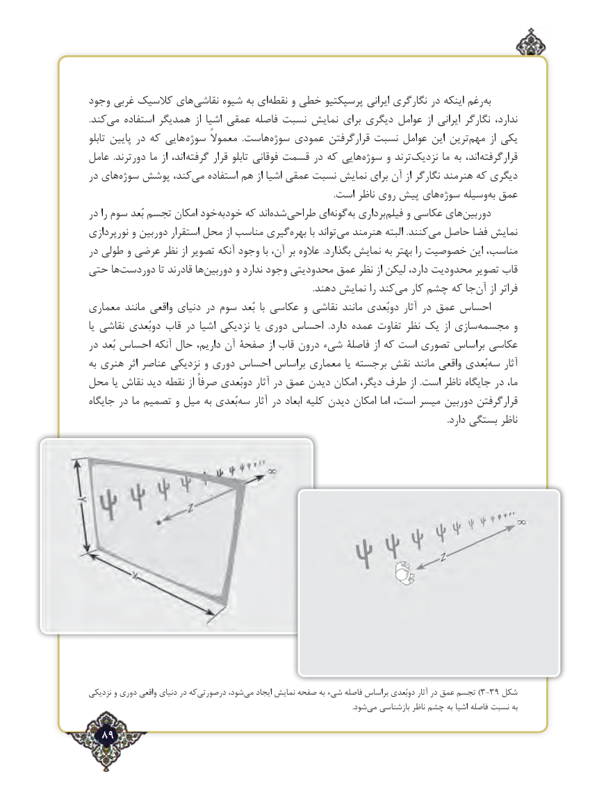

# PDF page 89

وجود غربی کالسیک های‌نقاشی شیوه به ای‌نقطه و خطی پرسپکتیو ایرانی نگارگری در اینکه رغمبه‌
.کندمی‌   استفاده همدیگر از اشیا عمقی فاصله نسبت نمایش برای دیگری عوامل از ایرانی نگارگر ندارد،
تابلو پایین در که هایی  سوژه معموالً  .هاستسوژه‌    عمودی قرارگرفتن نسبت عوامل این ترین ‌مهم از یکی
عامل  .دورترند ما از اند، گرفته قرار تابلو فوقانی قسمت در که هاییسوژه‌     و ترند ‌نزدیک ما به اند،  قرارگرفته
در های ‌سوژه پوشش کند،می‌   استفاده هم از اشیا عمقی نسبت نمایش برای آن از نگارگر هنرمند که دیگری
       .‌است ناظر روی پیش های‌سوژه وسیله ‌به عمق
در را سوم بُعد تجسم امکان خودخودبه‌     که اندشده‌    ‌طراحی ای‌گونهبه‌  برداریفیلم‌    و عکاسی های ‌دوربین
نورپردازی و دوربین استقرار محل از مناسب گیریبهره‌      با تواند ‌می هنرمند البته .کنندمی‌  حاصل فضا نمایش
در طولی و عرضی نظر از تصویر آنکه وجود با آن، بر عالوه .بگذارد نمایش به بهتر را خصوصیت این مناسب،
حتی ها‌دوردست تا قادرند هادوربین‌      و ندارد وجود محدودیتی عمق نظر از لیکن دارد، محدودیت تصویر قاب
     .‌دهند نمایش را کندمی کار چشم که جا ‌آن از فراتر
معماری مانند واقعی دنیای در سوم بُعد  با عکاسی و نقاشی مانند دوبُعدی آثار در عمق احساس
یا نقاشی دوبُعدی قاب در اشیا نزدیکی یا دوری احساس  .دارد عمده تفاوت نظر یک از سازی‌مجسمه و
در بُعد احساس آنکه حال داریم، آن صفحۀ از قاب درون شیء فاصلۀ از که است تصوری براساس عکاسی
به هنری اثر عناصر نزدیکی و دوری احساس براساس معماری یا برجسته ‌ نقش مانند واقعی بُعدی ‌سه آثار
محل یا نقاش دید نقطه از صرفاً دوبُعدی آثار در عمق دیدن امکان دیگر، طرف از  .است ناظر جایگاه در ما،
جایگاه در ما تصمیم و میل به بُعدی‌سه آثار در ابعاد کلیه دیدن امکان اما است، میسر دوربین قرارگرفتن
                                                                                                                                                                  .دارد بستگی ناظر

نزدیکی و دوری واقعی دنیای در که‌درصورتی شود،‌)می ایجاد نمایش صفحه به شیء فاصله براساس دوبُعدی آثار در عمق تجسم 3-39 شکل
                              .‌شود می بازشناسی ناظر چشم به اشیا فاصله نسبت به
  89٢

