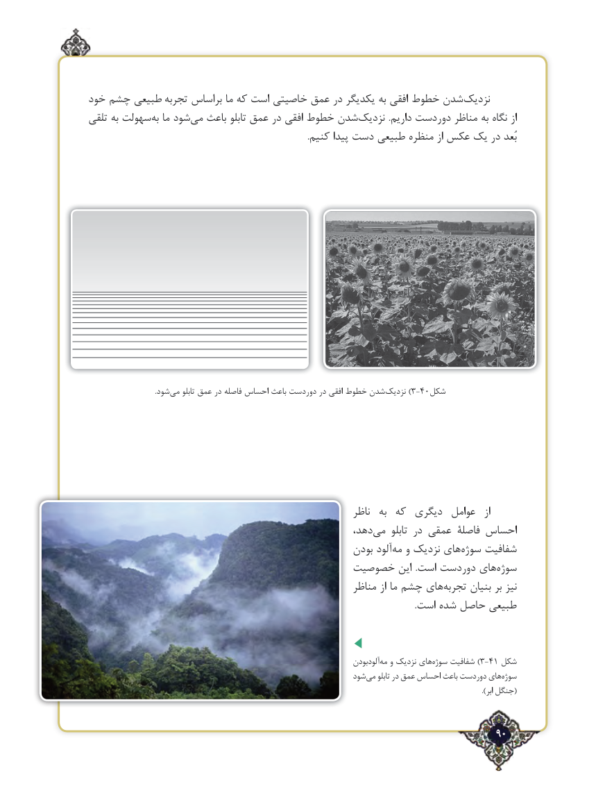

# PDF page 90

خود چشم طبیعی تجربه براساس ما که است خاصیتی عمق در یکدیگر به افقی خطوط شدن ‌نزدیک
تلقی به سهولت‌به ما شود‌می باعث تابلو عمق در افقی خطوط شدن‌نزدیک .داریم دوردست مناظر به نگاه از
                                                                                                   .کنیم پیدا دست طبیعی منظره از عکس یک در بُعد

                                       .شود‌می تابلو عمق در فاصله احساس باعث دوردست در افقی خطوط شدن‌)نزدیک 3-40شکل

                                                              ناظر  به  که  دیگری  عوامل   از
                                                      دهد،‌می  تابلو در عمقی فاصلۀ احساس
                                                     بودن آلودمه‌  و نزدیک های ‌سوژه شفافیت
                                      خصوصیت این  .است دوردست های ‌سوژه
                                                         مناظر از ما چشم های ‌تجربه بنیان بر نیز
              .‌است شده حاصل طبیعی

                                                                               آلودبودنمه‌  و نزدیک هایسوژه‌)شفافیت 3-41 شکل
                                                             شودمی‌    تابلو در عمق احساس باعث دوردست هایسوژه‌
                                                                                                                                                                              ).ابر جنگل(

                                                                  ٢90

