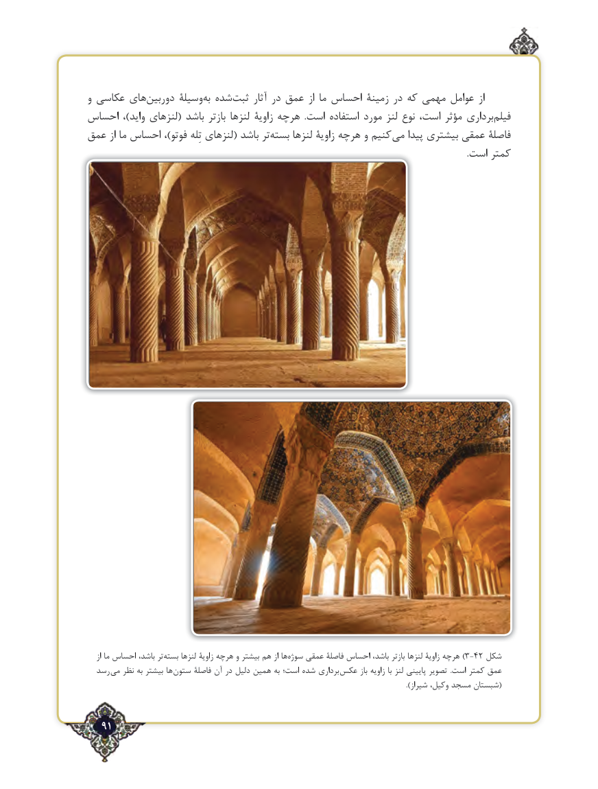

# PDF page 91

و عکاسی های‌دوربین وسیلۀ‌به شده‌ثبت آثار در عمق از ما احساس زمینۀ در که مهمی عوامل از
احساس  ،)واید لنزهای( باشد بازتر لنزها زاویۀ هرچه  .است استفاده مورد لنز نوع است، مؤثر برداری ‌فیلم
عمق از ما احساس ،)فوتو تِله لنزهای( باشد تر‌بسته لنزها زاویۀ هرچه و کنیم  می پیدا بیشتری عمقی فاصلۀ
                                                                                                                                                                              .است کمتر

    از ما احساس باشد، تر‌بسته لنزها زاویۀ هرچه و بیشتر هم از ها ‌)سوژه عمقی فاصلۀ احساس باشد، بازتر لنزها زاویۀ هرچه 3-42 شکل
  رسد می نظر به بیشتر ها ستون فاصلۀ آن در دلیل همین به است؛ شده برداری  عکس باز زاویه با لنز پایینی تصویر  .است کمتر عمق
                                                                                                                                           ).شیراز وکیل، مسجد شبستان(

   91٢

