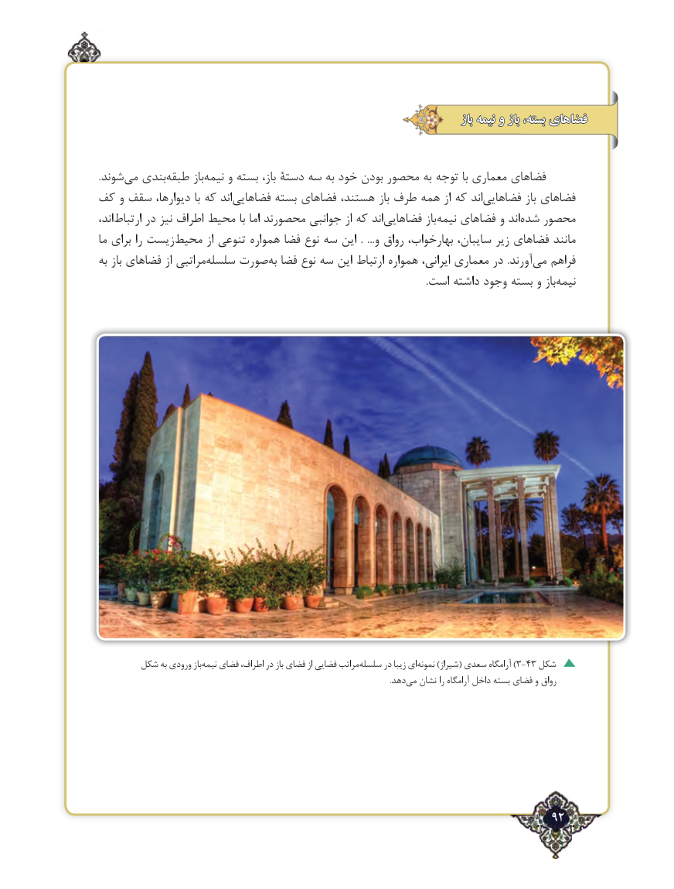

# PDF page 92

باز نیمه و باز بسته، فضاهای

.شوند‌می بندی ‌طبقه باز‌نیمه و بسته باز، دستۀ سه به خود بودن محصور به توجه با معماری فضاهای
کف و سقف دیوارها، با که اند ‌فضاهایی بسته فضاهای هستند، باز طرف همه از که اند ‌فضاهایی باز فضاهای
اند، ‌ارتباط در نیز اطراف محیط با اما محصورند جوانبی از که اند ‌فضاهایی باز ‌نیمه فضاهای و اندشده‌   محصور
ما برای را زیست ‌محیط از تنوعی همواره فضا نوع سه این  .  ...و رواق بهارخواب، سایبان، زیر فضاهای مانند
به باز فضاهای از مراتبی ‌سلسله صورت‌به فضا نوع سه این ارتباط همواره ایرانی، معماری در  .آورند ‌می فراهم
     .‌است داشته وجود بسته و بازنیمه

       شکل به ورودی بازنیمه‌   فضای اطراف، در باز فضای از فضایی مراتبسلسله‌     در زیبا اینمونه‌))شیراز( سعدی آرامگاه 3-43 شکل
                               .‌دهدمی نشان را آرامگاه داخل بسته فضای و رواق

                                                                   92٢

