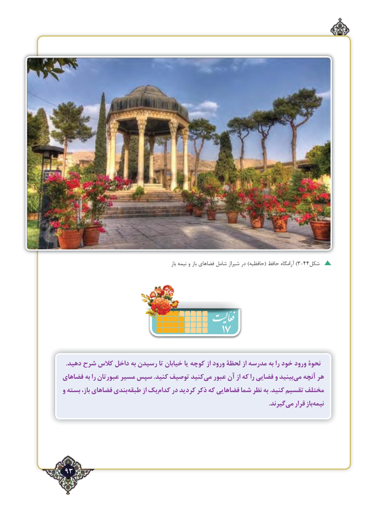

# PDF page 93

باز‌نیمه و باز فضاهای شامل شیراز در )حافظیه( حافظ آرامگاه ) 3-44شکل

                                   17
  .دهید شرح کالس داخل به رسیدن تا خیابان یا کوچه از ورود لحظۀ از مدرسه‌       به را خود ورود نحوۀ
فضاهای به را عبورتان مسیر سپس .کنید توصیف کنیدمی‌  عبور آن از که را فضایی و بینیدمی‌  آنچه هر
و بسته باز، فضاهای بندیطبقه‌      از یککدام‌    در کردید ذکر که فضاهایی شما نظر به .کنید تقسیم مختلف
                      .‌گیرندمی قرار بازنیمه‌

 93٢

