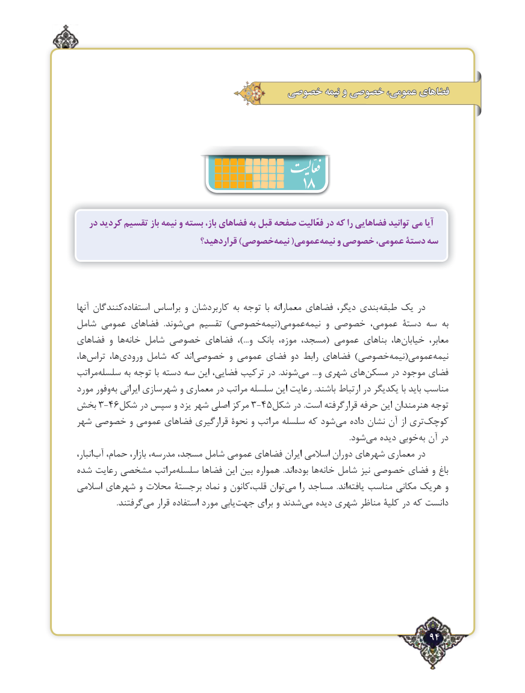

# PDF page 94

خصوصی نیمه و خصوصی عمومی، فضاهای

                                    18
   در كرديد تقسيم باز‌نیمه و بسته باز، فضاهای به قبل صفحه فعّاليت در كه را فضاهايي توانيد مي آيا
                              قراردهيد؟ )خصوصینیمه‌     (عمومینیمه‌    و خصوصی عمومی، دستۀ سه

آنها کنندگاناستفاده‌      براساس و کاربردشان به توجه  با معمارانه فضاهای دیگر، بندی  طبقه یک در
شامل عمومی فضاهای   .شوند‌می تقسیم )خصوصی‌نیمه(عمومی ‌نیمه و خصوصی عمومی، دستۀ سه به
فضاهای و ها‌خانه شامل خصوصی فضاهای  ،...)و بانک موزه، مسجد،( عمومی بناهای ها، ‌خیابان معابر،
ها،‌تراس ها،‌ورودی شامل که اند ‌خصوصی و عمومی فضای دو رابط فضاهای )خصوصی‌نیمه(عمومی‌نیمه
مراتب ‌سلسله به توجه با دسته سه این فضایی، ترکیب در  .شوند ‌می  ...و شهری های‌مسکن در موجود فضای
مورد وفور ‌به ایرانی شهرسازی و معماری در مراتب ‌سلسله این رعایت .باشند ارتباط در یکدیگر با باید مناسب
بخش 3-46شکل در سپس و یزد شهر اصلی مرکز 3-45شکل در .است قرارگرفته حرفه این هنرمندان توجه
شهر خصوصی و عمومی فضاهای قرارگیری نحوۀ و مراتب‌ سلسله که شود‌می داده نشان آن از تری‌کوچک
                                                                                                                                              .شود‌می دیده خوبیبه‌ آن در
انبار،‌آب حمام، بازار، مدرسه، مسجد، شامل عمومی فضاهای ایران اسالمی دوران شهرهای معماری در
شده رعایت مشخصی مراتب ‌سلسله فضاها این بین همواره  .اند‌بوده ها‌خانه شامل نیز خصوصی فضای و ‌باغ
اسالمی شهرهای و محالت برجستۀ نماد و قلب،کانون توان‌می را مساجد  .اند ‌یافته مناسب مکانی هریک و
   .‌گرفتندمی قرار استفاده مورد یابی‌جهت برای و شدند ‌می دیده شهری مناظر کلیۀ در که دانست

                                                                  94٢

