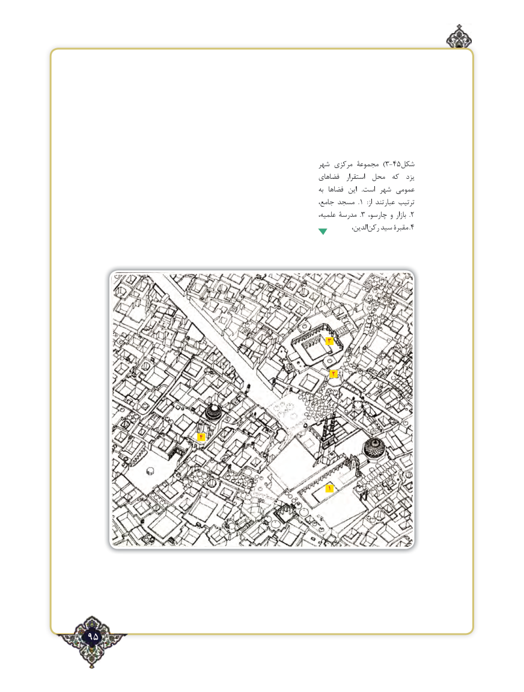

# PDF page 95

شهر مرکزی مجموعۀ  )3-45شکل
                                                                  فضاهای   استقرار  محل  که  یزد
                                                                                         به فضاها  این   .است شهر عمومی
                                                                         جامع، مسجد  .1  :از عبارتند ترتیب
                                                                               علمیه، مدرسۀ  .3  ،چارسو و بازار  . 2
                                                                                                   ،الدینرکن‌   سید مقبرۀ .4

                                                           3

                                                                      2

                               4

                                                                                                 1

95٢

