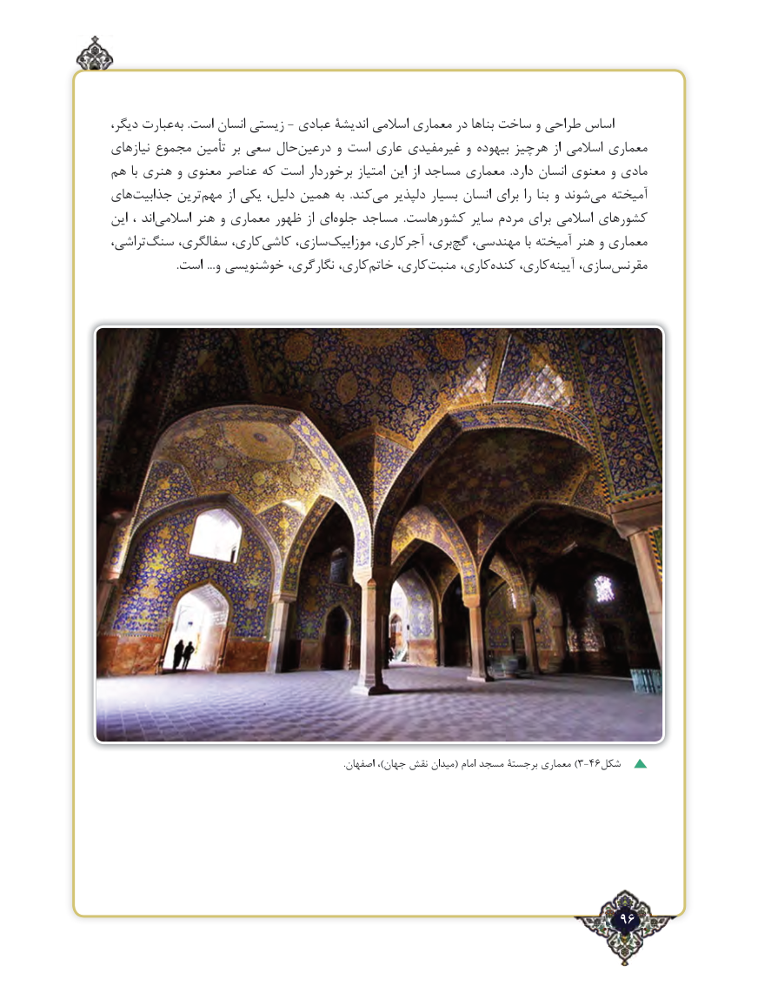

# PDF page 96

،دیگر عبارت‌       ‌به .است انسان زیستی - عبادی اندیشۀ اسالمی معماری در بناها ساخت و طراحی اساس
نیازهای مجموع تأمین بر سعی حال‌درعین و است عاری غیرمفیدی و بیهوده هرچیز از اسالمی معماری
هم با هنری و معنوی عناصر که است برخوردار امتیاز این از مساجد معماری  .دارد انسان معنوی و مادی
های ‌جذابیت ترین‌مهم از یکی دلیل، همین به  .کندمی‌   دلپذیر بسیار انسان برای را بنا و شوند‌می آمیخته
این ، اند‌اسالمی هنر و معماری ظهور از ای‌جلوه مساجد  .کشورهاست سایر مردم برای اسالمی کشورهای
تراشی،‌سنگ سفالگری، کاری،‌کاشی سازی،‌موزاییک آجرکاری، بری،‌گچ مهندسی، با آمیخته هنر و معماری
 .‌است ...و خوشنویسی نگارگری، کاری، خاتم کاری،‌منبت کاری،‌کنده کاری،‌آیینه سازی،‌مقرنس

                                                                                                              .اصفهان ،)جهان ‌)نقش میدان( امام مسجد برجستۀ معماری 3-46شکل

                                                                   96٢

