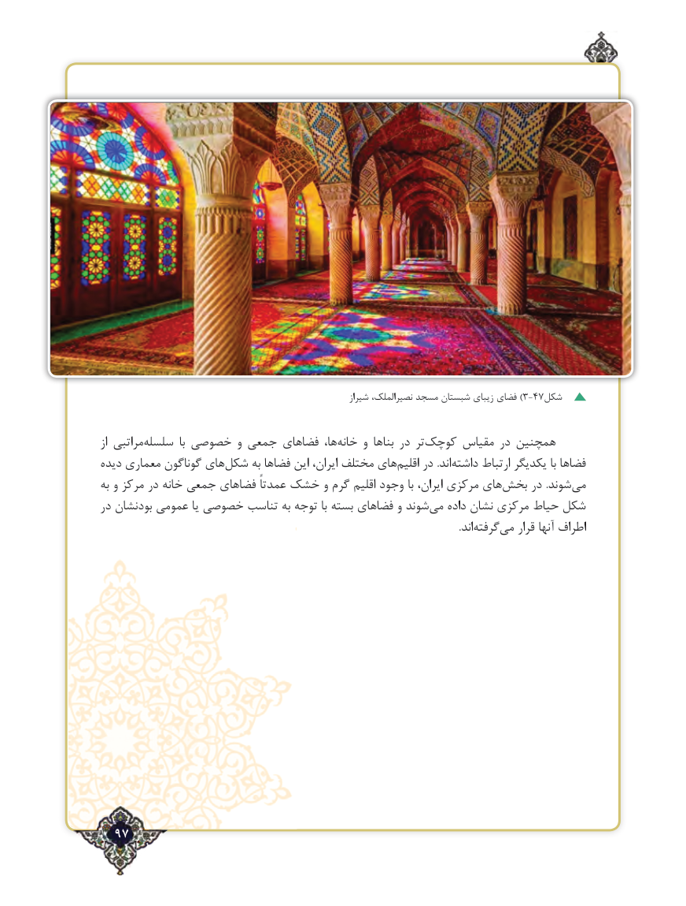

# PDF page 97

شیراز نصیرالملک، مسجد شبستان زیبای فضای ) 3-47شکل

از مراتبیسلسله‌          با خصوصی و جمعی های ‌فضا ها، ‌خانه و بناها در تر ‌کوچک مقیاس در همچنین
دیده معماری گوناگون های‌شکل به فضاها این ایران، مختلف های ‌اقلیم در .اند داشته‌      ارتباط یکدیگر با فضاها
به و مرکز در خانه جمعی فضاهای عمدتاً خشک و گرم اقلیم وجود با ایران، مرکزی های‌بخش در  .شوند ‌می
در بودنشان عمومی یا خصوصی تناسب به توجه با بسته فضاهای و شوند‌می داده نشان مرکزی حیاط شکل
                                       .‌اند گرفته‌می قرار آنها اطراف

  97٢

