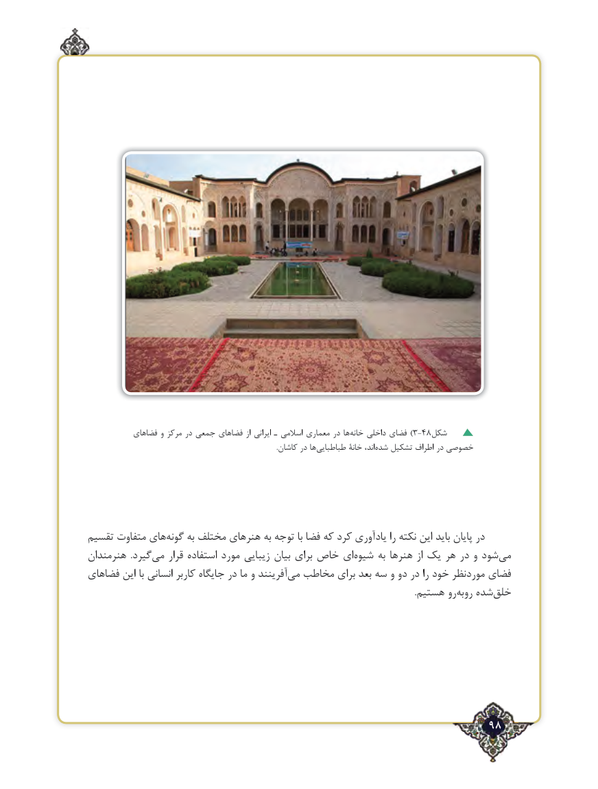

# PDF page 98

فضاهای و مرکز در جمعی فضاهای از ایرانی ـ اسالمی معماری در هاخانه‌)داخلی فضای 3-48شکل
         .‌کاشان در ها طباطبایی خانۀ اند،‌شده ‌تشکیل اطراف در خصوصی

تقسیم متفاوت های ‌گونه به مختلف هنرهای به توجه با فضا که کرد یادآوری را نکته این باید پایان در
هنرمندان  .گیردمی‌    قرار استفاده مورد زیبایی بیان برای خاص ای ‌شیوه به هنرها از یک هر در و شود‌می
فضاهای این با انسانی کاربر جایگاه در ما و آفرینند ‌می مخاطب برای بعد سه و دو در را خود موردنظر فضای
              .‌هستیم روبه ‌رو شده‌خلق

                                                              98٢

