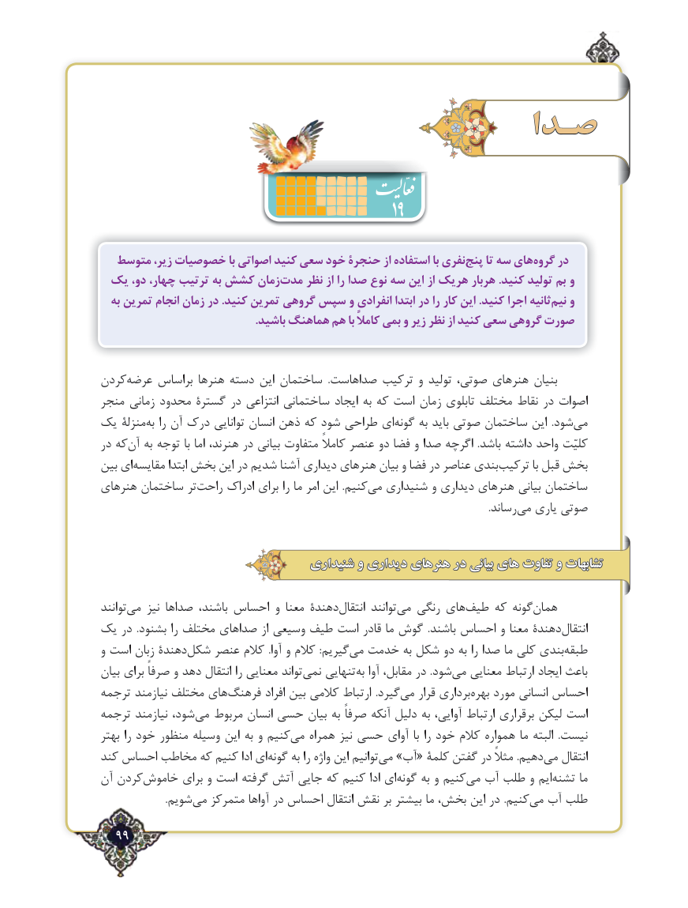

# PDF page 99

صـدا
                                                19
  متوسط زیر، خصوصیات با اصواتی کنید سعی خود حنجرۀ از استفاده با نفریپنج‌    تا سه هایگروه‌    در
 یک دو، چهار، ترتیب به کشش زمانمدت‌    نظر از را صدا نوع سه این از هریک هربار .کنید تولید بم و
  به تمرین انجام زمان در .کنید تمرین گروهی سپس و انفرادی ابتدا در را کار این .کنید اجرا ثانیهنیم‌   و
                                                      .باشید هماهنگ هم با کامالً بمی و زیر نظر از کنید سعی گروهی صورت

كردنعرضه‌     براساس هنرها دسته این ساختمان  .صداهاست ترکیب و توليد صوتی، هنرهای بنیان
منجر زمانی محدود گسترۀ در انتزاعی ساختمانی ایجاد به که است زمان تابلوی مختلف نقاط در اصوات
یک منزلۀ‌به را آن درک توانایی انسان ذهن که شود طراحی ای ‌گونه به باید صوتی ساختمان این  .شود ‌می
در که ‌آن به توجه با اما هنرند، در بیانی متفاوت کامالً عنصر دو فضا و صدا اگرچه  .باشد داشته واحد کلیّت
بین ای ‌مقایسه ابتدا بخش این در شدیم آشنا دیداری هنرهای بیان و فضا در عناصر بندی ‌ترکیب با قبل بخش
هنرهای ساختمان تر‌راحت ادراک برای را ما امر این  .کنیممی‌  شنیداری و دیداری هنرهای بیانی ساختمان
                        .‌رساند می یاری صوتی

                                 شنیداری و دیداری هنرهای در بیانی های تفاوت و تشابهات

توانند‌می نیز صداها باشند، احساس و معنا دهندۀ‌انتقال توانند ‌می رنگی های‌طیف که گونههمان‌
یک در  .بشنود را مختلف صداهای از وسیعی طیف است قادر ما گوش  .باشند احساس و معنا دهندۀ‌انتقال
و است زبان دهندۀشکل‌    عنصر کالم  .آوا و کالم  :گیریم‌می خدمت به شکل دو به را صدا ما کلی بندی‌طبقه
بیان برای صرفاً و دهد انتقال را معنایی تواند‌نمی تنهایی‌به آوا مقابل، در .شود‌می معنایی ارتباط ایجاد باعث
ترجمه نیازمند مختلف های‌فرهنگ افراد بین کالمی ارتباط  .گیردمی‌   قرار برداری‌بهره مورد انسانی احساس
ترجمه نیازمند شود، ‌می مربوط انسان حسی بیان به صرفاً آنکه دلیل به آوایی، ارتباط برقراری لیکن است
بهتر را خود منظور وسیله این به و کنیممی‌   همراه نیز حسی آوای با را خود کالم همواره ما البته  .نیست
کند احساس مخاطب که کنیم ادا ای ‌گونه به را واژه این توانیم‌می »آب« کلمۀ گفتن در مثالً .دهیم‌می انتقال
آن کردنخاموش‌       برای و است گرفته ‌آتش جایی که کنیم ادا ای ‌گونه به و کنیم‌می آب طلب و ایم‌تشنه ما
    .‌شویم می متمرکز آواها در احساس انتقال نقش بر بیشتر ما بخش، این در .کنیممی‌  آب طلب
  99٢

