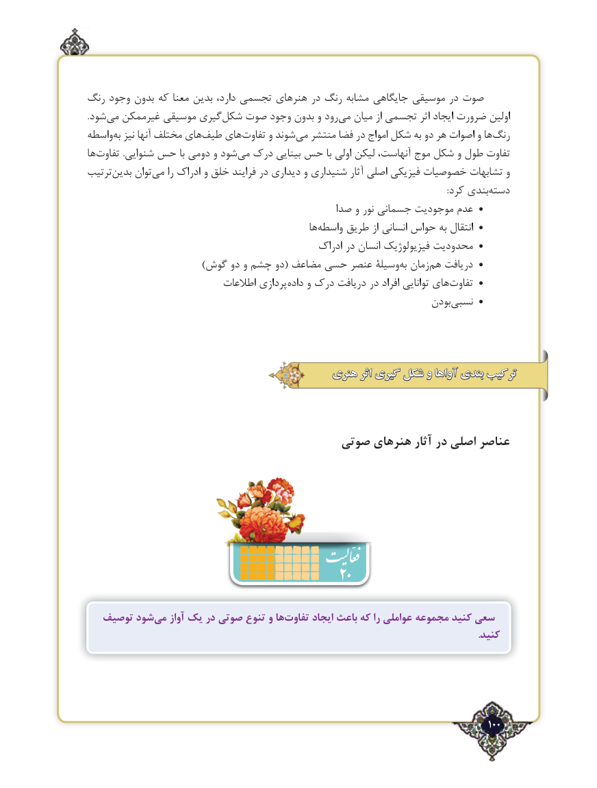

# PDF page 100

رنگ وجود بدون که معنا بدین دارد، تجسمی هنرهای در رنگ مشابه جایگاهی موسیقی در صوت
.شود‌می غیرممکن موسیقی گیریشکل‌   صوت وجود بدون و رود ‌می میان از تجسمی اثر ایجاد ضرورت اولین
واسطه‌به نیز آنها مختلف های ‌طیف های‌تفاوت و شوند ‌می منتشر فضا در امواج شکل به دو هر اصوات و ها‌رنگ
ها ‌تفاوت .شنوایی حس با دومی و شود ‌می درک بینایی حس با اولی لیکن آنهاست، موج شکل و طول تفاوت
ترتیب‌بدین توان‌می را ادراک و خلق فرایند در دیداری و شنیداری آثار اصلی فیزیکی خصوصیات تشابهات و
                :‌کرد بندیدسته
                                               صدا و نور جسمانی موجودیت عدم •
                                                     ها‌واسطه طریق از انسانی حواس به انتقال •
                                                 ادراک در انسان فیزیولوژیک محدودیت •
                               )گوش دو و چشم دو( مضاعف حسی عنصر وسیلۀبه‌  زمان ‌هم دریافت •
                             اطالعات پردازی‌داده و درک دریافت در افراد توانایی های‌تفاوت •
                                                                      بودننسبی‌     •

                                       هنری اثر گیری شکل و آواها بندی ترکیب

                                   صوتی هنرهای آثار در اصلی عناصر

                                           20
   توصیف شودمی‌   آواز یک در صوتی تنوع و هاتفاوت‌      ایجاد باعث که را عواملی مجموعه کنید سعی
                                                                                                                                                              .کنید

                                                                                            100٢

