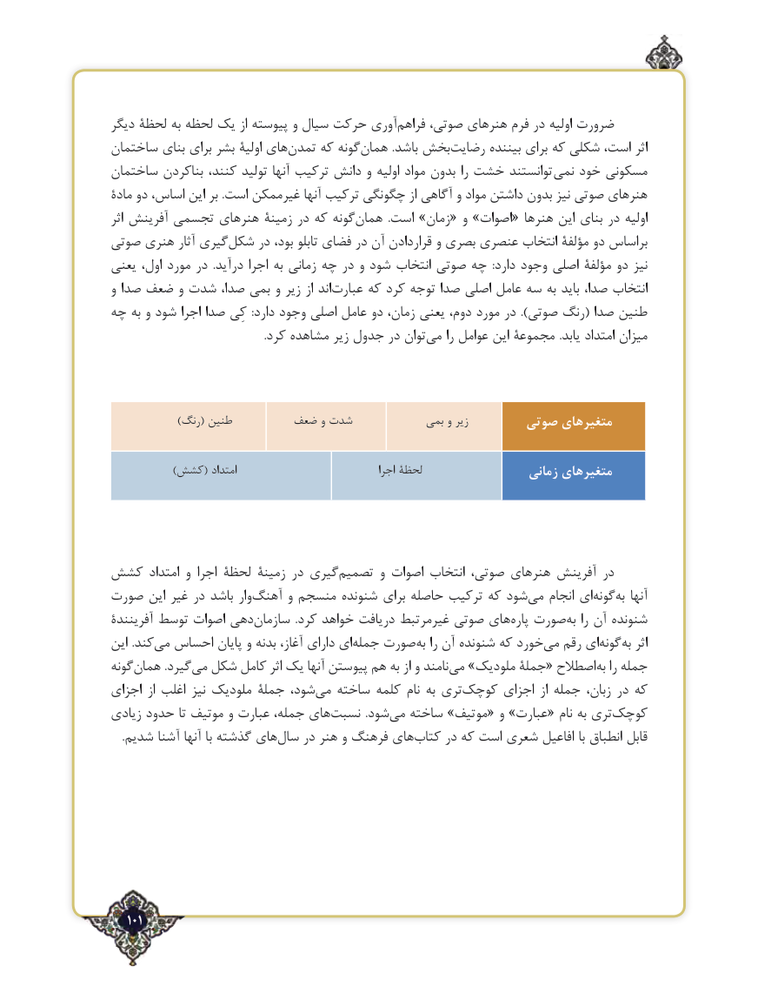

# PDF page 101

دیگر لحظۀ به لحظه یک از پیوسته و سیال حرکت آوری‌فراهم صوتی، هنرهای فرم در اولیه ضرورت
ساختمان بنای برای بشر اولیۀ های ‌تمدن که گونه‌همان .باشد بخش ‌رضایت بیننده برای که شکلی است، اثر
ساختمان بناکردن کنند، تولید آنها ترکیب دانش و اولیه مواد بدون را خشت توانستند نمی خود مسکونی
مادۀ دو اساس، این بر .است غیرممکن آنها ترکیب چگونگی از آگاهی و مواد داشتن بدون نیز صوتی هنرهای
اثر آفرینش تجسمی هنرهای زمینۀ در که گونههمان‌          .است »زمان« و »اصوات« هنرها این بنای در اولیه
صوتی هنری آثار گیری‌شکل در بود، تابلو فضای در آن قراردادن و بصری عنصری انتخاب مؤلفۀ دو براساس
یعنی اول، مورد در  .درآید اجرا به زمانی چه در و شود انتخاب صوتی چه  :دارد وجود اصلی مؤلفۀ دو نیز
و صدا ضعف و شدت صدا، بمی و زیر از اند ‌عبارت که کرد توجه صدا اصلی عامل سه به باید صدا، انتخاب
چه به و شود اجرا صدا کِی  :دارد وجود اصلی عامل دو زمان، یعنی دوم، مورد در ).صوتی رنگ( صدا طنین
  .‌کرد مشاهده زیر جدول در توان می را عوامل این مجموعۀ .یابد امتداد میزان

                )رنگ( طنین        ضعف و شدت            بمی و زیر       صوتی متغیرهای

               )کشش( امتداد                                  اجرا لحظۀ                  زمانی متغیرهای

کشش امتداد و اجرا لحظۀ زمینۀ در گیریتصمیم‌       و اصوات انتخاب صوتی، هنرهای آفرینش در
صورت این غیر در باشد وارآهنگ‌      و منسجم شنونده برای حاصله ترکیب که شود ‌می انجام ای‌گونهبه‌  آنها
آفرینندۀ توسط اصوات دهیسازمان‌             .کرد خواهد دریافت غیرمرتبط صوتی های ‌پاره صورت ‌به را آن شنونده
این .کند‌می احساس پایان و بدنه آغاز، دارای ای‌جمله صورت ‌به را آن شنونده که خورد‌می رقم ای‌گونهبه‌  اثر
گونههمان‌          .گیردمی‌  شکل کامل اثر یک آنها پیوستن هم به از و نامند‌می »ملودیک جملۀ« اصطالح‌به را جمله
اجزای از اغلب نیز ملودیک جملۀ شود، ‌می ساخته کلمه نام به تری ‌کوچک اجزای از جمله زبان، در که
زیادی حدود تا موتیف و عبارت جمله، های ‌نسبت  .شود‌می ساخته »موتیف« و »عبارت« نام به تری‌کوچک
.‌شدیم آشنا آنها با گذشته های سال در هنر و فرهنگ های‌کتاب در که است شعری افاعیل با انطباق قابل

   101٢

