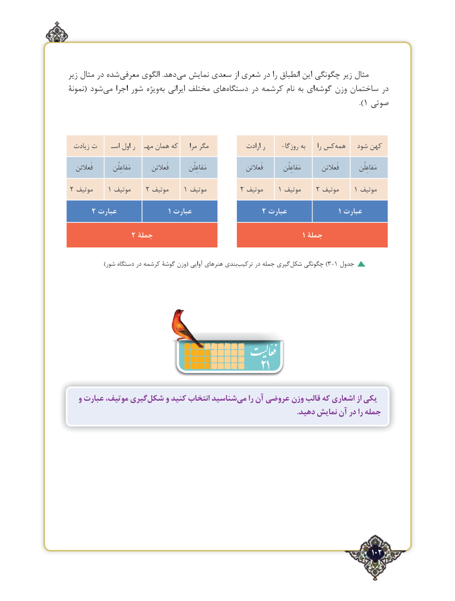

# PDF page 102

زیر مثال در شده‌معرفی الگوی  .دهد‌می نمایش سعدی از شعری در را انطباق این چگونگی زیر مثال
نمونۀ( شود‌می اجرا شور ویژه ‌به ایرانی مختلف های ‌دستگاه در کرشمه نام به ای ‌گوشه وزن ساختمان در
                                                                                              ).1 صوتی

  زیادت ت     اسـ اول ر   مهـ همان که     مرا مگر             ارادت ر     -روزگا به      را کسهمه‌      شود کهن

   فَعالتن          مَفاعِلُن        فَعالتن          مَفاعِلُن                فَعالتن          مَفاعِلُن        فَعالتن          مَفاعِلُن

2 موتیف    1 موتیف    2 موتیف    1 موتیف        2 موتیف    1 موتیف    2 موتیف    1 موتیف

      2 عبارت                 1 عبارت                 2 عبارت                 1 عبارت

               2 جملۀ                                                   1 جملۀ

 )‌شور دستگاه در کرشمه گوشۀ وزن( آوایی هنرهای بندیترکیب در جمله گیریشکل‌)چگونگی 3-1 جدول

                                             21
   و عبارت موتیف، گیریشکل‌     و کنید انتخاب شناسیدمی‌    را آن عروضی وزن قالب که اشعاری از یکی
                                                                                                                         .دهید نمایش آن در را جمله

                                                                                   102٢

