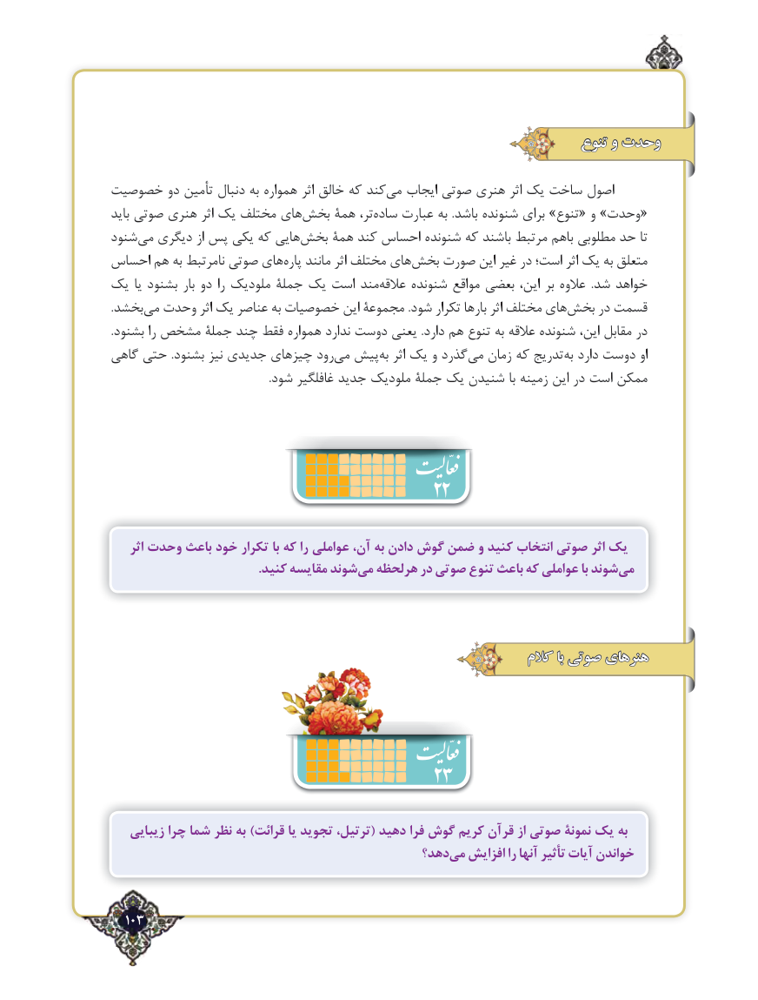

# PDF page 103

تنوع و وحدت

خصوصیت دو تأمین دنبال به همواره اثر خالق که کندمی‌   ایجاب صوتی هنری اثر یک ساخت اصول
باید صوتی هنری اثر یک مختلف های ‌بخش همۀ تر،‌«ساده عبارت به  .باشد شنونده برای »تنوع« و »وحدت
شنود‌می دیگری از پس یکی که هایی ‌بخش همۀ کند احساس شنونده که باشند مرتبط باهم مطلوبی حد تا
احساس هم به نامرتبط صوتی های‌پاره مانند اثر مختلف های ‌بخش صورت این غیر در است؛ اثر یک به متعلق
یک یا بشنود بار دو را ملودیک جملۀ یک است مند‌عالقه شنونده مواقع بعضی این، بر عالوه  .شد خواهد
.بخشد ‌می وحدت اثر یک عناصر به خصوصیات این مجموعۀ .شود تکرار بارها اثر مختلف های‌بخش در قسمت
.بشنود را مشخص جملۀ چند فقط همواره ندارد دوست یعنی .دارد هم تنوع به عالقه شنونده این، مقابل در
گاهی حتی .بشنود نیز جدیدی چیزهای رودمی‌  پیشبه‌  اثر یک و گذرد ‌می زمان که تدریج ‌به دارد دوست او
                                                         .شود غافلگیر جدید ملودیک جملۀ یک شنیدن با زمینه این در است ممکن

                                       22
    اثر وحدت باعث خود تکرار با که را عواملی آن، به دادن گوش ضمن و کنید انتخاب صوتی اثر یک
   .‌کنید مقایسه شوندمی هرلحظه در صوتی تنوع باعث که عواملی با شوندمی‌

                                                                 کالم با صوتی هنرهای

                                  23
   زیبایی چرا شما نظر به )قرائت یا تجوید ترتیل،( دهيد فرا گوش كريم قرآن از صوتي نمونۀ یک به
                                             دهد؟می‌  افزایش را آنها تأثیر آیات خواندن

  103٢

