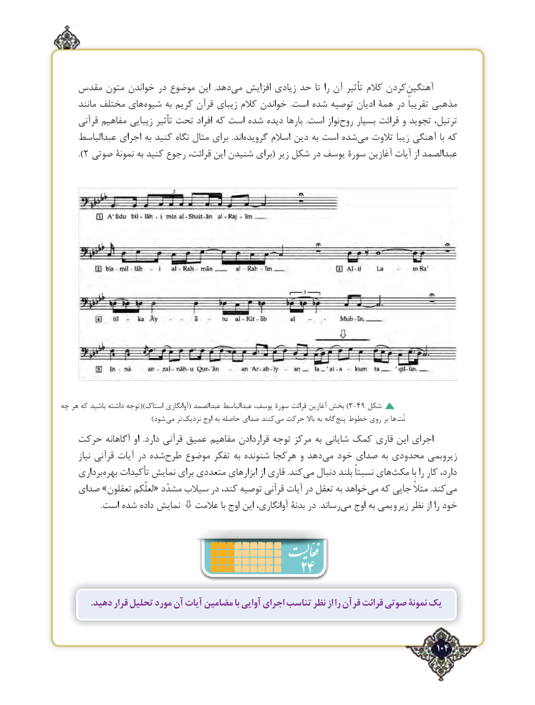

# PDF page 104

مقدس متون خواندن در موضوع این  .دهدمی‌   افزایش زیادی حد تا را آن تأثیر کالم کردنآهنگین‌
     مانند مختلف های ‌شیوه به کریم قرآن زیبای کالم خواندن  .است شده توصیه ادیان همۀ در تقریباً مذهبی
    قرآنی مفاهیم زیبایی تأثیر تحت افراد که است شده دیده بارها  .است نواز ‌روح بسیار قرائت و تجوید ترتیل،
    عبدالباسط اجرای به کنید نگاه مثال برای  .اند ‌گرویده اسالم دین به است شده‌می تالوت زیبا آهنگی با که
     ).2 صوتی نمونۀ به کنید رجوع قرائت، این شنیدن برای( زیر شکل در یوسف سورۀ آغازین آیات از عبدالصمد

چه هر که باشید داشته توجه)( استاک آوانگاری( عبدالصمد عبدالباسط یوسف، سورۀ قرائت آغازین بخش )3-49 شکل
           ) شود می تر نزدیک اوج به حاصله صدای کنند  می حرکت باال به گانه پنج خطوط روی بر ها نُت
   حرکت آگاهانه او  .دارد قرآنی عمیق مفاهیم قراردادن توجه مرکز به شایانی کمک قاری این اجرای
      نیاز قرآنی آیات در شده ‌طرح موضوع تفکر به شنونده هرکجا و دهد ‌می خود صدای به محدودی زیروبمی
    برداری‌بهره تأکیدات نمایش برای متعددی ابزارهای از قاری .کندمی‌   دنبال بلند نسبتاً های‌مکث با را کار دارد،
   صدای »تعقلون لعلّکم« مشدّد سیالب در کند، توصیه قرآنی آیات در تعقل به خواهدمی‌  که جایی مثالً .کندمی‌
                    .است شده داده نمایش   عالمت با اوج این آوانگاری، بدنۀ در .رساندمی‌   اوج به بمی و زیر نظر از را خود
                                    24
             .دهید قرار تحلیل مورد آن آیات مضامین با آوایی اجرای تناسب نظر از را قرآن قرائت صوتی نمونۀ یک

                                                                                       104٢

