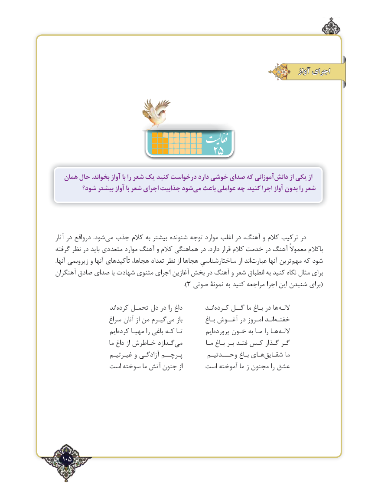

# PDF page 105

آواز اجرای

                              25
   همان حال .بخواند آواز با را شعر یک کنید درخواست دارد خوشی صدای که آموزانیدانش‌      از یکی از
        شود؟ بیشتر آواز با شعر اجرای جذابیت شودمی‌  باعث عواملی چه .کنید اجرا آواز بدون را شعر

آثار در درواقع  .شود‌می جذب کالم به بیشتر شنونده توجه موارد اغلب در آهنگ، و کالم ترکیب در
گرفته نظر در باید متعددی موارد آهنگ و کالم هماهنگی در .دارد قرار کالم خدمت در آهنگ معموالً باکالم
.آنها زیروبمی و آنها تأکیدهای هجاها، تعداد نظر از هجاها ساختارشناسیِ از اند‌عبارت آنها ترین‌مهم که شود
آهنگران صادق صدای با شهادت مثنوی اجرای آغازین بخش در آهنگ و شعر انطباق به کنید نگاه مثال برای
                                                  ).3 صوتی نمونۀ به کنید مراجعه اجرا این شنیدن برای(

                         اند‌کرده تحمـل دل در را داغ          انـدکـرده‌    گــل ما بـاغ در ها ‌اللـه
                 سراغ آنان از من گیـرم‌می باز         بـاغ آغــوش در امـروز انـد‌خفتـه
                      ایمکرده‌     مهیـا را باغی کـه تـا         ایم‌پرورده خـون به مـا را هـااللـه‌
                       ما داغ از خـاطرش گـدازد‌می          مـا بـاغ بـر فتـد کـس گـذار گـر
                   غیـرتیـم و آزادگـی پـرچــم        وحـــدتیـم بـاغ هـای ‌شقـایق ما
              است سوخته ما آتش جنون از      است آموخته ما ز مجنون را عشق

  105٢

