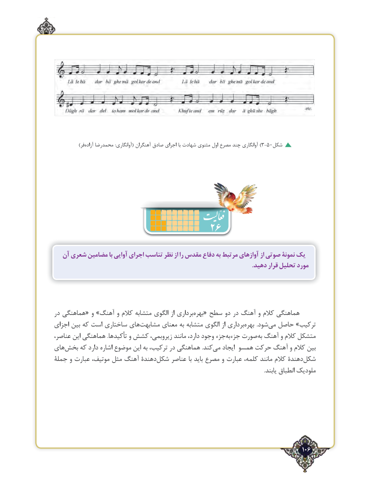

# PDF page 106

)فر ‌)آزاده محمدرضا :آوانگاری( آهنگران صادق اجرای با شهادت مثنوی اول مصرع چند آوانگاری 3-50شکل

                              26
  آن شعری مضامین با آوایی اجرای تناسب نظر از را مقدس دفاع به مرتبط آوازهای از صوتی نمونۀ یک
                                                                                                                                 .دهید قرار تحلیل مورد

در هماهنگی« و »آهنگ و کالم متشابه الگوی از برداریبهره‌  « سطح دو در آهنگ و کالم هماهنگی
اجزای بین که است ساختاری هایمشابهت‌       معنای به متشابه الگوی از برداریبهره‌        .شودمی‌  حاصل »ترکیب
عناصر، این هماهنگی .تأکیدها و کشش زیروبمی، مانند دارد، وجود جزءجزءبه‌    صورتبه‌ آهنگ و کالم متشکل
هایبخش‌    که دارد اشاره موضوع این به ترکیب، در هماهنگی .کندمی‌   ایجاد همسو حرکت آهنگ و کالم بین
جملۀ و عبارت موتیف، مثل آهنگ دهندۀشکل‌    عناصر با باید مصرع و عبارت کلمه، مانند کالم دهندۀشکل‌
                                                                                                                                                            .یابند انطباق ملودیک

                                                                                   106٢

