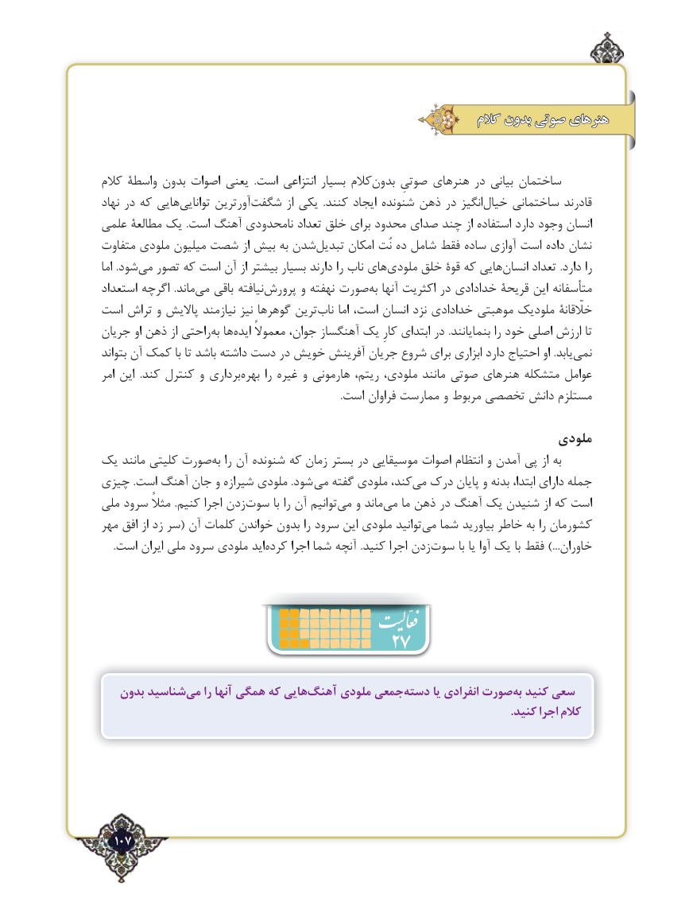

# PDF page 107

کالم بدون صوتی هنرهای

کالم واسطۀ بدون اصوات یعنی  .است انتزاعی بسیار کالم ‌بدون صوتیِ هنرهای در بیانی ساختمان
نهاد در که هایی‌توانایی آورترین‌شگفت از یکی  .کنند ایجاد شنونده ذهن در انگیزخیال‌    ساختمانی قادرند
علمی مطالعۀ یک .است آهنگ نامحدودی تعداد خلق برای محدود صدای چند از استفاده دارد وجود انسان
متفاوت ملودی میلیون شصت از بیش به شدن ‌تبدیل امکان نُت ده شامل فقط ساده آوازی است ‌داده نشان
اما .شود‌می تصور که است آن از بیشتر بسیار دارند را ناب های‌ملودی خلق قوۀ که هایی ‌انسان تعداد .دارد را
استعداد اگرچه  .ماند ‌می باقی نیافته‌پرورش و نهفته صورت‌به آنها اکثریت در خدادادی قریحۀ این متأسفانه
است تراش و پاالیش نیازمند نیز گوهرها ترین ‌ناب اما است، انسان نزد خدادادی موهبتی ملودیک خلّقانۀ
جریان او ذهن از راحتیبه‌  ها‌ایده معموالً جوان، آهنگساز یک کارِ ابتدای در .بنمایانند را خود اصلی ارزش تا
بتواند آن کمک با تا باشد داشته دست در خویش آفرینش جریان شروع برای ابزاری دارد احتیاج او .یابد‌نمی
امر این  .کند کنترل و برداری ‌بهره را غیره و هارمونی ریتم، ملودی، مانند صوتی هنرهای متشکله عوامل
                                                                                               .است فراوان ممارست و مربوط تخصصی دانش مستلزم

                                                                   ملودی
یک مانند کلیتی صورت‌به را آن شنونده که زمان بستر در موسیقایی اصوات انتظام و آمدن پی از به
چیزی .است آهنگ جان و شیرازه ملودی .شود  می گفته ملودی کند،‌می درک پایان و بدنه ابتدا، دارای جمله
ملی سرود مثالً  .کنیم اجرا زدن‌سوت با را آن توانیم ‌می و ماند ‌می ما ذهن در آهنگ یک شنیدن از که است
مهر افق از زد سر( آن کلمات خواندن بدون را سرود این ملودی توانید‌می شما بیاورید خاطر به را کشورمان
.‌است ایران ملی سرود ملودی اید کرده اجرا شما آنچه .کنید اجرا زدنسوت‌        با یا آوا یک با فقط ...)خاوران

                               27
   بدون شناسیدمی‌    را آنها همگی که هاییآهنگ‌     ملودی جمعیدسته‌       یا انفرادی صورتبه‌  کنید سعی
                                                                                                                                              .کنید اجرا کالم

  107٢

