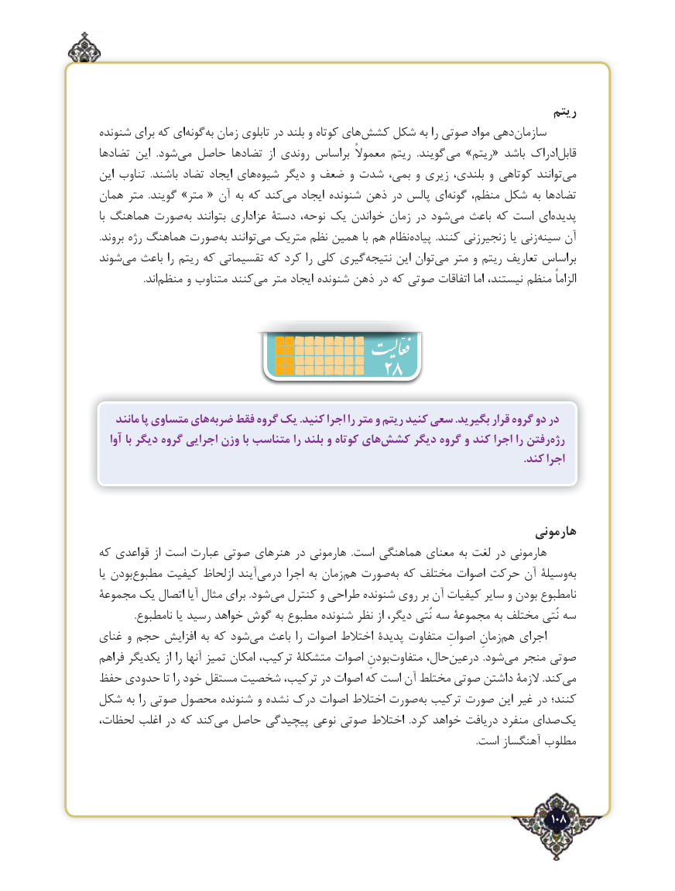

# PDF page 108

ریتم
شنونده برای که ای‌گونهبه‌  زمان تابلوی در بلند و کوتاه های ‌کشش شکل به را صوتی مواد دهیسازمان‌
ها‌تضاد این  .شود‌می حاصل تضادها  از روندي براساس معموالً ريتم  .گویند  می »ریتم« باشد ادراک‌قابل
این تناوب  .باشند تضاد ایجاد های ‌شیوه دیگر و ضعف و شدت بمی، و زیری بلندی، و کوتاهی توانند‌می
همان متر  .گویند »متر « آن به که کند‌می ایجاد شنونده ذهن در پالس ای ‌گونه منظم، شکل به ها‌تضاد
با هماهنگ صورت ‌به بتوانند عزاداری دستۀ نوحه، یک خواندن زمان در شود‌می باعث که است ای‌پدیده
.بروند رژه هماهنگ صورت‌به توانند‌می متریک نظم همین با هم نظام‌پیاده  .کنند زنجیرزنی یا زنیسینه‌    آن
شوند ‌می باعث را ریتم که تقسیماتی که کرد را کلی گیری‌نتیجه این توان ‌می متر و ریتم تعاریف براساس
     .‌اندمنظم و متناوب کنندمی‌   متر ایجاد شنونده ذهن در که صوتی اتفاقات اما نیستند، منظم الزاماً

                               28
    مانند پا متساوی هایضربه‌   فقط گروه یک .کنید اجرا را متر و ریتم کنید سعی .بگیرید قرار گروه دو در
   آوا با دیگر گروه اجرایی وزن با متناسب را بلند و کوتاه هایکشش‌     دیگر گروه و کند اجرا را رفتنرژه‌
                                                                                                                                                        .کند اجرا

                                                                         هارمونی
که قواعدی از است عبارت صوتی هنرهای در هارمونی  .است هماهنگی معنای به لغت در هارمونی
یا بودنمطبوع‌     کیفیت ازلحاظ آیند‌درمی اجرا به زمان ‌هم صورت‌به که مختلف اصوات حرکت آن وسیلۀ ‌به
مجموعۀ یک اتصال آیا مثال برای .شود‌می کنترل و طراحی شنونده روی بر آن کیفیات سایر و بودن ‌نامطبوع
              .نامطبوع یا رسید خواهد گوش به مطبوع شنونده نظر از دیگر، نُتی سه مجموعۀ به مختلف نُتی سه
غنای و حجم افزایش به که شود‌می باعث را اصوات اختالط پدیدۀ متفاوت اصواتِ زمانِ‌هم اجرای
فراهم یکدیگر از را آنها تمیز امکان ترکیب، متشکلۀ اصوات بودنِمتفاوت‌      حال،‌درعین  .شود‌می منجر صوتی
حفظ حدودی تا را خود مستقل شخصیت ترکیب، در اصوات که است آن مختلط صوتی داشتن الزمۀ .کند‌می
شکل به را صوتی محصول شنونده و نشده درک اصوات اختالط صورت‌به ترکیب صورت این غیر در کنند؛
لحظات، اغلب در که کندمی‌  حاصل پیچیدگی نوعی صوتی اختالط  .کرد خواهد دریافت منفرد صدای ‌یک
                                                                                                                                                         .است آهنگساز مطلوب

                                                                                   108٢

