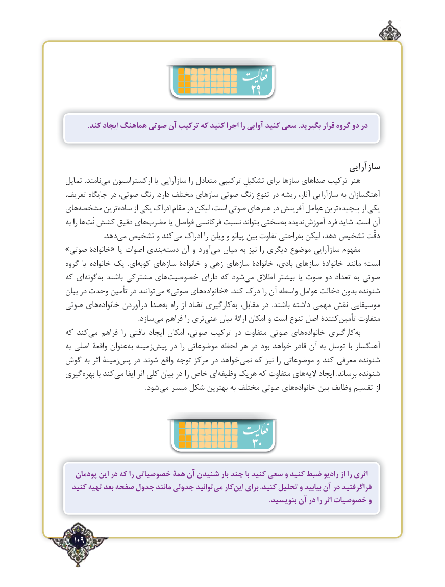

# PDF page 109

.کند ایجاد هماهنگ صوتی آن ترکیب که کنید اجرا را آوایی کنید سعی .بگیرید قرار گروه دو در

                                                                         سازآرایی
تمایل .نامندمی‌   ارکستراسیون یا سازآرایی را متعادل ترکیبی‌      تشکیلِ برای سازها صداهای ترکیب هنر
تعریف، جایگاه در صوتی، رنگ .دارد مختلف سازهای صوتی رَنگ تنوع در ریشه آثار، سازآرایی به آهنگسازان
هایمشخصه‌       ترینساده‌      از یکی ادراک مقام در لیکن است، صوتی هنرهای در آفرینش عوامل ترینپیچیده‌         از یکی
به را هانُت‌ کشش دقیق هایمضرب‌        یا فواصل فرکانسی نسبت بتواند سختیبه‌  ندیدهآموزش‌      فرد شاید .است آن
                       .دهدمی‌  تشخیص و کندمی‌   ادراک را ویلن و پیانو بین تفاوت راحتیبه‌ لیکن دهد، تشخیص دقّت
»صوتی خانوادۀ« یا اصوات بندی‌دسته آن و آورد‌می میان به نیز را دیگری موضوع سازآرایی مفهوم
گروه یا خانواده یک  .ای ‌کوبه سازهای خانوادۀ و زهی سازهای خانوادۀ بادی، سازهای خانوادۀ مانند است؛
که ای‌گونهبه‌  باشند مشترکی های ‌خصوصیت دارای که شود‌می اطالق بیشتر یا صوت دو تعداد به صوتی
بیان در وحدت تأمین در توانند می‌  »صوتی های ‌خانواده« .کند درک را آن واسطه عوامل دخالت بدون شنونده
صوتی های ‌خانواده درآوردن صدا ‌به راه از تضاد کارگیری‌به مقابل، در  .باشند داشته مهمی نقش موسیقایی
        .‌سازد می فراهم را تری‌غنی بیان ارائۀ امکان و است تنوع اصل کنندۀتأمین‌     متفاوت
که کندمی‌   فراهم  را بافتی ایجاد امکان صوتی، ترکیب در متفاوت صوتی های‌خانواده کارگیریبه‌
به اصلی واقعۀ عنوانبه‌  زمینه‌پیش در را موضوعاتی لحظه هر در بود خواهد قادر آن به توسل با آهنگساز
گوش به اثر زمینۀپس‌   در شوند واقع توجه مرکز در خواهدنمی‌   که نیز را موضوعاتی و کند معرفی شنونده
گیری‌بهره با کندمی‌    ایفا اثر کلی بیان در را خاص ای ‌وظیفه هریک که متفاوت های ‌الیه ایجاد .برساند شنونده
          .‌شودمی میسر شکل بهترین به مختلف صوتی های ‌خانواده بین وظایف تقسیم از

                                     30
   پودمان این در که را خصوصیاتی همۀ آن شنیدن بار چند با کنید سعی و کنید ضبط رادیو از را اثری
  کنید تهیه بعد صفحه جدول مانند جدولی توانیدمی‌   کاراین‌   برای .کنید تحلیل و بیابید آن در فراگرفتید
                                                                                                              .بنویسید آن در را اثر خصوصیات و

  109٢

