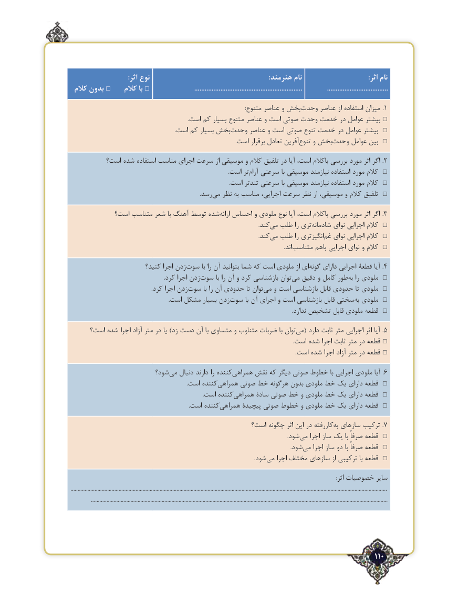

# PDF page 110

:اثر نوع                                                                     :هنرمند نام                                      :اثر نام
 کالم بدون □    کالم با □                         ..............................................................              ...................................
    :‌.متنوع عناصر و بخش وحدت عناصر از استفاده میزان 1
 .□است کم بسیار متنوع عناصر و است صوتی وحدت خدمت در عوامل بیشتر
 .‌□است کم بسیار بخشوحدت عناصر و است صوتی تنوع خدمت در عوامل بیشتر
     .‌است برقرار تعادل آفرین تنوع و بخش ‌□وحدت عوامل بین
         است؟ شده استفاده مناسب اجرای سرعت از موسیقی و کالم تلفیق در آیا است، باکالم بررسی مورد اثر اگر . 2
                                                                                                                .است تر‌□آرام سرعتی با موسیقی نیازمند استفاده مورد کالم
                                                                                                                .است تندتر سرعتی با موسیقی نیازمند استفاده مورد کالم □
  .‌□رسدمی نظر به مناسب اجرایی، سرعت نظر از موسیقی، و کالم تلفیق
            است؟ متناسب شعر با آهنگ توسط شده‌.ارائه احساس و ملودی نوع آیا است، باکالم بررسی مورد اثر اگر 3
                                                                                                                                     .کندمی‌  طلب را تری‌□شادمانه نوای اجرایی کالم
                            .‌کندمی طلب را انگیزتری‌□غم نوای اجرایی کالم
      .‌□اندمتناسب باهم اجرایی نوای و کالم
                        کنید؟ اجرا زدنسوت‌        با را آن بتوانید شما که است ملودی از ای‌.گونه دارای اجرایی قطعۀ آیا 4
                                                                  .کرد اجرا زدنسوت‌        با را آن و کرد بازشناسی توان‌می دقیق و کامل طور‌□به را ملودی
    .‌کرد اجرا زدنسوت با را آن حدودی تا توان‌□می و است بازشناسی قابل حدودی تا ملودی
   .‌است مشکل بسیار زدنسوت با آن اجرای و است بازشناسی قابل سختی‌□به ملودی
                                                                                                                                                             .ندارد تشخیص قابل ملودی قطعه □
     است؟ شده اجرا آزاد متر در یا )زد دست آن با متساوی و متناوب ضربات با توان ‌.می( دارد ثابت متر اجرایی اثر آیا 5
     .□است شده اجرا ثابت متر در قطعه
                                                                                                                                                               .است شده اجرا آزاد متر در قطعه □
                        شود؟ ‌می دنبال دارند را کنندههمراهی‌.نقش که دیگر صوتی خطوط با اجرایی ملودی آیا 6
                                                                                  .است کنندههمراهی‌□صوتی خط هرگونه بدون ملودی خط یک دارای قطعه
  .‌□است کنندههمراهی سادۀ صوتی خط و ملودی خط یک دارای قطعه
  .‌□است کنندههمراهی پیچیدۀ صوتی خطوط و ملودی خط یک دارای قطعه
                                                است؟ چگونه اثر این در کاررفته‌.به سازهای ترکیب 7
                                                                                                                                                         .شود ‌□می اجرا ساز یک با صرفاً قطعه
       .‌□شودمی اجرا ساز دو با صرفاً قطعه
    .‌□شودمی اجرا مختلف سازهای از ترکیبی با قطعه
                                                                                                                                                                                            :اثر خصوصیات سایر
................................................................................................................................................................................................................................
              ..................................................................................................................................................................................................................

                                                                                            110٢

