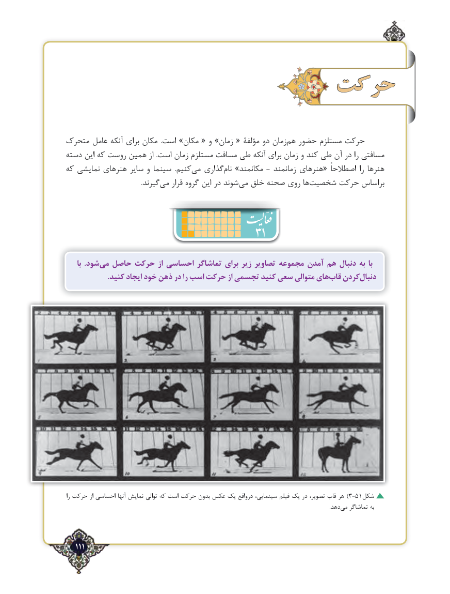

# PDF page 111

حرکت

متحرک عامل آنکه برای مکان  .است »مکان « و »زمان « مؤلفۀ دو زمان ‌هم حضور مستلزم حرکت
دسته این که روست همین از .است زمان مستلزم مسافت طی آنکه برای زمان و کند طی آن در را مسافتی
که نمایشی هنرهای سایر و سینما  .کنیممی‌   گذاری‌نام »مکانمند - زمانمند هنرهای« اصطالحاً را هنرها
       .‌گیرندمی قرار گروه این در شوند ‌می خلق صحنه روی ها ‌شخصیت حرکت براساس
                                      31
     با  .شودمی‌  حاصل حرکت از احساسی تماشاگر برای زیر تصاویر مجموعه آمدن هم دنبال به با
.‌کنید ایجاد خود ذهن در را اسب حرکت از تجسمی کنید سعی متوالی هایقاب کردندنبال‌

را حرکت از احساسی آنها نمایش توالی که است حرکت بدون عکس یک درواقع سینمایی، فیلم یک در تصویر، قاب هر )3-51شکل
                                         .‌دهدمی تماشاگر به

   111٢

