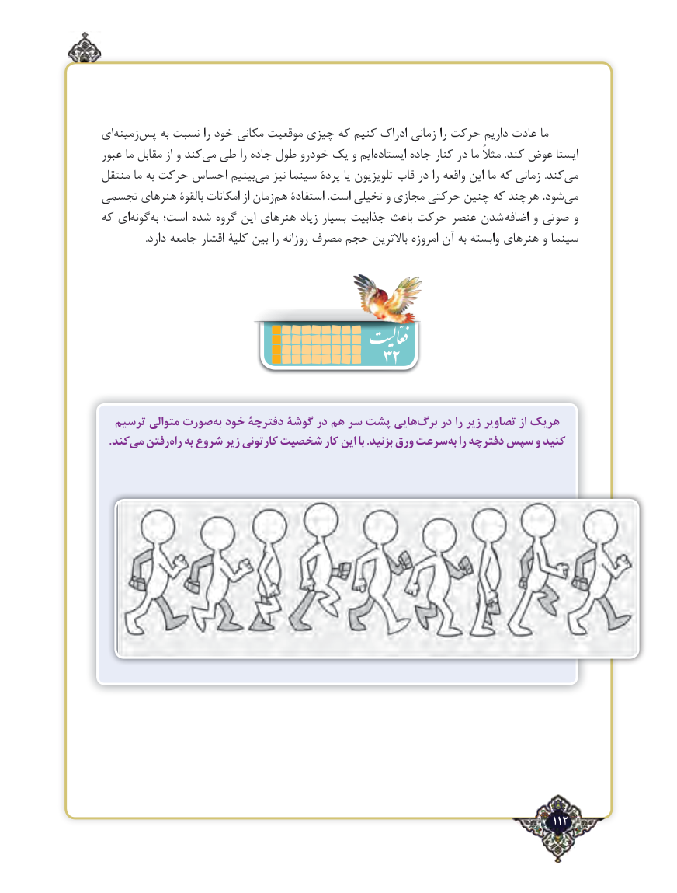

# PDF page 112

ای‌زمینهپس‌    به‌نسبت را خود مکانی موقعیت چیزی که کنیم ادراک زمانی را حرکت داریم عادت ما
عبور ما مقابل از و کندمی‌  طی را جاده طول خودرو یک و ایم ‌ایستاده جاده کنار در ما مثالً .کند عوض ایستا
منتقل ما به حرکت احساس بینیممی‌   نیز سینما پردۀ یا تلویزیون قاب در را واقعه این ما که زمانی .کند ‌می
تجسمی هنرهای بالقوۀ امکانات از زمان‌هم استفادۀ .است تخیلی و مجازی حرکتی چنین که هرچند شود، ‌می
که ای ‌گونهبه‌  است؛ شده گروه این هنرهای زیاد بسیار جذابیت باعث حرکت عنصر شدن  اضافه و صوتی و
                  .دارد جامعه اقشار کلیۀ بین را روزانه مصرف حجم باالترین امروزه آن به وابسته هنرهای و سینما

                                 32

  ترسیم متوالی صورتبه‌ خود دفترچۀ گوشۀ در هم سر پشت هاییبرگ‌    در را زیر تصاویر از هریک
 .‌کندمی رفتنراه‌  به شروع زیر کارتونی شخصیت کار این با .بزنید ورق سرعتبه‌  را دفترچه سپس و کنید

                                                                                   112٢

