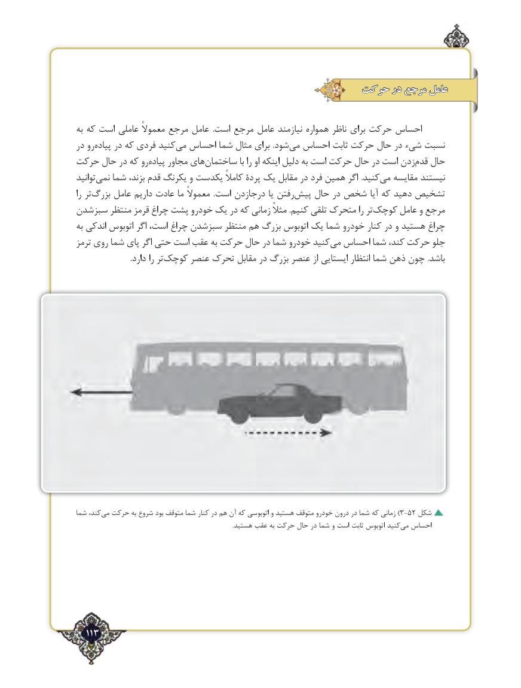

# PDF page 113

حرکت در مرجع عامل

به که است عاملی معموالً مرجع عامل  .است مرجع عامل نیازمند همواره ناظر برای حرکت احساس
در روپیاده‌    در که فردی کنیدمی‌  احساس شما مثال برای .شودمی‌  احساس ثابت حرکت حال در شیء نسبت
حرکت حال در که روپیاده‌    مجاور هایساختمان‌              با را او اینکه دلیل به است حرکت حال در است زدنقدم‌   حال
توانیدنمی‌   شما بزند، قدم یکرنگ و یکدست کامالً پردۀ یک مقابل در فرد همین اگر .کنیدمی‌   مقایسه نیستند
را تربزرگ‌    عامل داریم عادت ما معموالً  .است درجازدن یا رفتنپیش‌    حال در شخص آیا که دهید تشخیص
سبزشدن منتظر قرمز چراغ‌   پشت خودرو یک در که زمانی مثالً .کنیم تلقی متحرک را ترکوچک‌     عامل و مرجع
به اندکی اتوبوس اگر است، چراغ سبزشدن منتظر هم بزرگ اتوبوس یک شما خودرو کنار در و هستید چراغ
ترمز روی شما پای اگر حتی است عقب به حرکت حال در شما خودرو کنیدمی‌  احساس شما کند، حرکت جلو
   .‌دارد را ترکوچک عنصر تحرک مقابل در بزرگ عنصر از ایستایی انتظار شما ذهن چون .باشد

شما کند،می‌  حرکت به شروع بود متوقف شما کنار در هم آن‌)که اتوبوسی و هستید متوقف خودرو درون در شما که زمانی 3-52 شکل
  .‌هستید عقب به حرکت حال در شما و است ثابت اتوبوس کنیدمی احساس

  113٢

